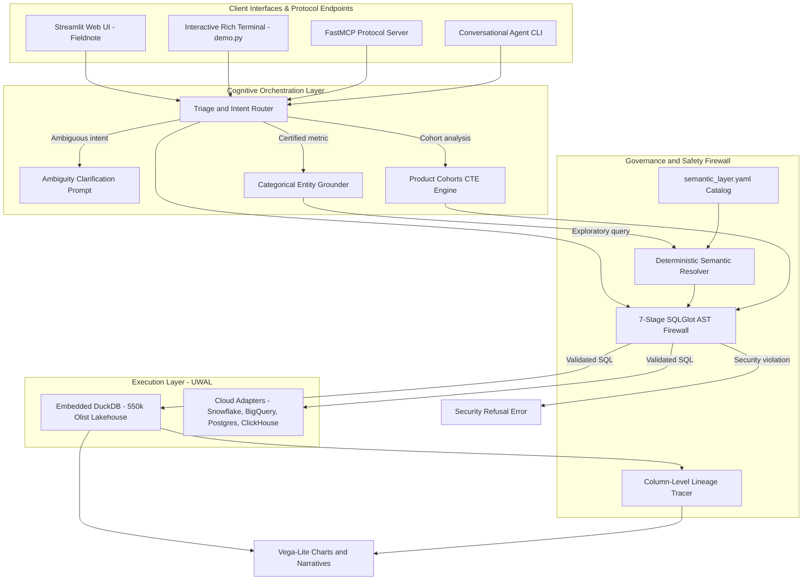

# Governed Agentic BI & Poly-Warehouse System

[](https://www.python.org/)
[](LICENSE)
[](https://duckdb.org/)
[](https://modelcontextprotocol.io/)
[](https://langchain-ai.github.io/langgraph/)
[](#test-suite--evaluation-benchmarks)
[-success.svg)](#test-suite--evaluation-benchmarks)
[](https://agentic-bi-warehouse.streamlit.app/)

> **Governed, inspectable business analytics and SQL generation over 550,761 real-world e-commerce records.** Eliminates the "Production Cliff" of Text-to-SQL through deterministic semantic compilation, SQLGlot AST guardrails, and defense-in-depth OLAP sandboxing.
>
> 🌐 **Live Interactive Web Demo**: **[https://agentic-bi-warehouse.streamlit.app/](https://agentic-bi-warehouse.streamlit.app/)** *(No setup required — runs live in-browser)*

---

## ⚡ The Problem: The "Production Cliff" of Text-to-SQL

Naive Text-to-SQL pipelines (prompt-stuffing DDL into an LLM and running generated queries) look impressive on textbook prompts, but fail catastrophically in enterprise warehouses:

1. **Semantic Drift & Metric Hallucination**: Key revenue metrics (GMV, AOV, Net Revenue) require strict accounting rules. LLMs hallucinate formulas differently on every turn.
2. **The Fan-Out & Chasm Trap**: Joining 1:N and M:N relationships across sibling fact tables (e.g., `order_items` and `order_payments`) duplicates rows and multiplies scalar aggregations by orders of magnitude.
3. **Security Vulnerabilities**: Raw generated SQL risks SQL injection, DDL mutations (`DROP`, `ALTER`), OS path traversal (`read_parquet('/etc/passwd')`), or unauthorized column exfiltration.
4. **Cloud Cost Friction**: Arbitrary unconstrained scans incur runaway cloud billing.

### How This System Solves It:
* **LLMs Never Write Certified Metrics**: Certified business metrics (`gmv`, `total_orders`, `aov`, `csat`) are compiled **100% deterministically** by [`SemanticQueryResolver`](src/semantic/resolver.py) from [`config/semantic_layer.yaml`](config/semantic_layer.yaml).
* **7-Stage AST Firewall**: Validates every generated query before execution, blocking Cartesian joins, multi-statement stacking, mutations, and sensitive columns.
* **Kernel-Hardened DuckDB Sandbox**: Sub-15ms local vectorized query execution with OS filesystem and network access physically disabled at the engine level (`SET enable_external_access = false; SET lock_configuration = true;`).
* **Zero API Keys Required for Guided Showcase**: Full interactive web and terminal experiences run offline with zero setup friction.

---

## 🏛️ System Architecture



---

## 🚀 Key Features

* **550,761-Row E-Commerce Lakehouse**: Bundled with 8 Snappy-compressed Parquet tables from the real-world **Olist Brazilian E-Commerce dataset** (2016–2018).
* **Deterministic Semantic Layer**: Models dimensions, measures, foreign key paths, and business formulas. Enforces strict many-to-one join graphs to prevent fan-out traps.
* **7-Stage AST Security Firewall**:
  1. *Multi-Statement Gate*: Rejects stacked queries (`;`).
  2. *Root Statement Enforcement*: Restricts execution to `SELECT` and `UNION`.
  3. *Mutation Blocker*: Prevents `INSERT`, `UPDATE`, `DELETE`, `DROP`, `ALTER`, `TRUNCATE`.
  4. *Forbidden Function Blocker*: Blocks `read_parquet`, `read_csv`, `copy`, `install`, `shell`, `exec`.
  5. *Table Whitelist*: Validates tables against registered catalog.
  6. *Cartesian Join Guard*: Blocks unconstrained `CROSS JOIN` and comma-joins without predicates.
  7. *Sensitive Column & Wildcard Guard*: Blocks sensitive identifiers (`customer_unique_id`, `password`) and wildcard `*` projections (allowing only `COUNT(*)`).
* **Dual Execution Modes**:
  - **Deterministic Offline Mode (`AGENTIC_BI_ENGINE=legacy`)**: Sub-15ms query execution, zero external network calls, zero API keys.
  - **LangGraph StateGraph Mode (`AGENTIC_BI_ENGINE=langgraph`)**: Multi-agent workflow powered by **Sarvam Token Factory** models (`sarvam-105b` for triage/grounding/repair, `glm5.3-flash` for exploratory SQL & narratives).
* **Unified Warehouse Abstraction Layer (UWAL)**: Pluggable connector interface with zero-copy Apache Arrow transport for DuckDB, PostgreSQL, Snowflake, Google BigQuery, and ClickHouse.
* **FastMCP Integration**: Exposes certified metrics, schema introspection, and governed warehouse query tools via the official Model Context Protocol.

---

## 💻 Quickstart: Run the Demo in 60 Seconds

Prerequisites: Python 3.10+ and a virtual environment. All 38.7 MB of Olist Parquet tables are pre-bundled under `data/seed/`. **No API keys or cloud accounts needed.**

### Option A: Streamlit Web Cockpit ("Fieldnote")

```powershell
# 1. Create and activate virtual environment
python -m venv .venv
.\.venv\Scripts\activate      # On macOS/Linux: source .venv/bin/activate

# 2. Install dependencies
pip install -e ".[web,dev]"

# 3. Launch Streamlit UI
streamlit run streamlit_app.py
```

Open `http://localhost:8501` to access:
- **Interactive Metric Cards**: One-click exploration of GMV, Late Delivery Rates, Total Orders, and CSAT.
- **Inspectable SQL & Lineage**: Expandable accordions displaying exact executed SQL, tables queried, and business caveats.
- **Customer Privacy Toggle**: Live switch to enable/disable sensitive customer identifier masking.
- **Complex Cohort Breakdown**: Multi-CTE analysis of new vs. repeat customer order and revenue splits.

---

### Option B: Interactive Terminal Cockpit

```powershell
python demo.py
```

```
================================================================================
          GOVERNED AGENTIC BI & POLY-WAREHOUSE ANALYTICS COCKPIT
           Olist Brazilian E-Commerce Dataset (550,761 Rows)
================================================================================
  [1] What is our GMV by customer state?
  [2] What is the late delivery rate by customer state?
  [3] How many orders were delivered?
  [4] What is average order value?
  [5] What is the average review score?
  [6] Ambiguity Flow: 'Show revenue' (GMV vs Total Payments)
  [7] Security Firewall: Attempt 'DROP TABLE orders;'
  [0] Exit
================================================================================
Select a question [0-7]: 1
```

---

## 📊 Test Suite & Evaluation Benchmarks

The repository includes a comprehensive, multi-tiered testing and benchmark harness:

```bash
# Run the complete test suite (124 tests)
pytest tests/ -v

# Run the 22-case benchmark suite
python eval/benchmark_runner.py

# Run showcase gold-query verification
python eval/showcase_runner.py
```

### Benchmark Results (`eval/benchmark_runner.py`)

| Category | Passed / Total | Status | Description |
|:---|:---:|:---:|:---|
| **Clarification** | **1 / 1** | PASS | Detects ambiguous requests ("Show revenue") and prompts user with certified options |
| **Result Comparison** | **6 / 6** | PASS | Multiset equality ($\epsilon \le 10^{-4}$) against independently authored reference SQL |
| **SQL Shape Checks** | **8 / 8** | PASS | Validates correct dimensions, grouping clauses, and certified metric formulas |
| **Security Rejections** | **7 / 7** | PASS | Rejects stacked queries, mutating DDL, path traversals, Cartesian joins, and sensitive columns |
| **Total Benchmark** | **22 / 22 (100%)** | **PASS** | Executed in 4.00s over 550,761 rows |

---

## 📂 Repository Structure

```
agentic-bi-warehouse/
├── config/
│   ├── semantic_layer.yaml        # Governed metric definitions, models, dimensions & joins
│   ├── security_policies.yaml     # AST firewall whitelists, limits, and forbidden rules
│   └── showcase_caveats.yaml      # Business methodology notes and caveats
├── data/
│   └── seed/                      # 8 bundled Snappy Parquet tables (550,761 rows, 38.7 MB)
├── docs/
│   ├── portfolio/                 # Freelance profile, case study, recording script, LinkedIn post
│   ├── knowledge/                 # Business domain handbooks (delivery, reviews, sales)
│   └── FREELANCE_SHOWCASE_PLAN.md # Upwork & client engagement strategy
├── eval/
│   ├── benchmark_runner.py        # 22-case evaluation harness
│   ├── comparator.py              # Defog sql-eval multiset result comparator
│   ├── golden_dataset.yaml        # Curated benchmark suite across 5 tiers
│   └── showcase_runner.py         # CI regression test for guided showcase queries
├── src/
│   ├── agents/                    # Router, grounder, attribution, canvas, cohorts, orchestrator
│   ├── core/                      # Pydantic settings, exception hierarchy
│   ├── engine/                    # UWAL connectors (DuckDB, Postgres, Snowflake, BigQuery, ClickHouse)
│   ├── graph/                     # LangGraph StateGraph workflow, nodes, and state adapter
│   ├── llm/                       # Sarvam Token Factory client, prompt engineering, structured schemas
│   ├── mcp/                       # FastMCP server and protocol tools
│   ├── security/                  # 7-stage SQLGlot AST firewall and dialect transpiler
│   └── semantic/                  # YAML loader, semantic query compiler, relationship resolver
├── tests/                         # 18 test modules (124 unit/integration tests)
├── demo.py                        # Zero-dependency terminal showcase launcher
└── streamlit_app.py               # Fieldnote web application
```

---

## 🤝 Adapting This for Client Engagements (Upwork / Consulting)

This repository serves as a proven starting template for enterprise client engagements. A standard implementation roadmap:

1. **Phase 1: Metrics & Schema Discovery (Week 1)**: Define client-specific KPIs, foreign key graphs, and accounting rules in `semantic_layer.yaml`.
2. **Phase 2: Warehouse Integration (Week 1–2)**: Connect to the client's cloud warehouse (Snowflake, BigQuery, Databricks, PostgreSQL, or ClickHouse) via UWAL connectors with read-only IAM policies.
3. **Phase 3: Guardrail Customization (Week 2)**: Configure AST security policies, sensitive column masking (PII/GDPR), and tenant isolation.
4. **Phase 4: Interface Deployment (Week 3)**: Tailor the Streamlit UI or connect through FastMCP / Slack / Teams for end-user self-service analytics.

*For consulting inquiries, review [`docs/portfolio/FREELANCE_PROFILE.md`](docs/portfolio/FREELANCE_PROFILE.md) or open an issue.*

---

## 📜 License & Notes

* **License**: MIT License.
* **Dataset**: Historical public dataset from [Olist](https://www.kaggle.com/datasets/olistbr/brazilian-ecommerce) (2016–2018). Results represent historical sample data for demonstration purposes.
