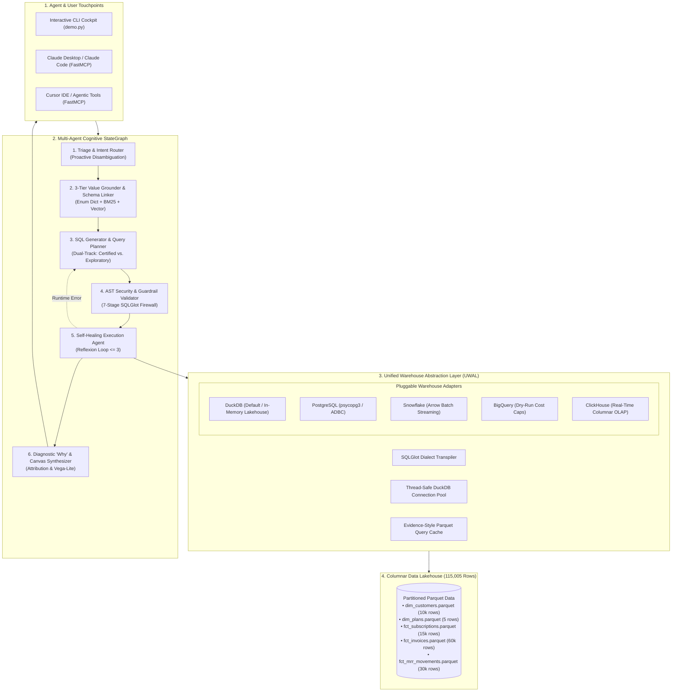

# Governed DuckDB Analytics Agent & Poly-Warehouse BI Engine

[](https://github.com/anujhsrsaini/agentic-bi-warehouse/actions)
[](https://opensource.org/licenses/Apache-2.0)
[](https://duckdb.org)
[](https://modelcontextprotocol.io)
[](https://python.org)

An enterprise-grade, governed analytical agent and poly-warehouse query engine. Built on **in-process vectorized DuckDB** with pluggable connectors for **Snowflake**, **Google BigQuery**, **PostgreSQL**, and **ClickHouse**, governed by a **YAML Semantic Layer** and protected by a **7-Stage SQLGlot AST Security Firewall**.

---

## ⚡ The 60-Second Zero-Setup Verification

No cloud accounts, credentials, or remote clusters required. Evaluators and CTOs can clone and launch the interactive terminal cockpit in under 5 seconds:

```bash
git clone https://github.com/anujhsrsaini/agentic-bi-warehouse.git
cd agentic-bi-warehouse
pip install -r requirements.txt

# Run the interactive zero-setup demo
python demo.py
```

---

## 1. The Problem: The "Spider 2.0 Reality Cliff"

Modern data teams want AI agents (Claude Code, Cursor, autonomous BI bots) to answer business questions directly from enterprise warehouses. However, naive Text-to-SQL fails in production:

* On clean, textbook academic schemas (**Spider 1.0**), LLMs score over **91.2%**.
* On enterprise data warehouses (**Spider 2.0 (ICLR 2025)**) with 1,000+ columns and real-world business context, accuracy drops to **21.3%**.

### Why Naive Text-to-SQL Fails:
1. **Hallucinated Business Logic**: When asked for *"Net Revenue Retention (NRR)"* or *"ARR"*, an LLM writes arbitrary sums without accounting for refunds, contraction, or churn cohorts.
2. **Join Traps (Fan-out & Chasm Traps)**: Joining multiple 1:N relations (customers $\to$ subscriptions and customers $\to$ invoices) causes Cartesian multiplication, reporting wildly inflated revenue figures.
3. **Categorical Value Mismatches (The #1 Failure Mode)**: Users ask for `"Google"`, but the database stores `"Alphabet Inc."`. Naive text-to-SQL filters on `company = 'Google'`, returning zero rows.
4. **Security & Sandbox Breaches**: Direct SQL execution risks SQL injection, mutating commands (`DROP TABLE`), and filesystem exfiltration (`read_parquet('/etc/passwd')`).

---

## 2. System Architecture



---

## 3. The 5 Breakthrough Innovations

1. **Automated Semantic Layer Bootstrapping (`src/semantic/bootstrapper.py`)**:
   - Inspects raw warehouse schemas, automatically identifies Fact vs Dimension tables, discovers foreign keys using sample set-inclusion testing, and generates candidate `semantic_layer.yaml` models in seconds.
2. **Column-Level Data Lineage & Mathematical Explainability (`src/engine/lineage.py`)**:
   - Answers *"Why is this number 108%?"* by traversing SQLGlot AST graphs to emit interactive **Mermaid DAGs**, **ASCII hierarchy trees**, and plain-English calculation narratives.
3. **3-Tier Categorical Entity Grounder (`src/agents/entity_grounder.py`)**:
   - Eliminates the #1 Text-to-SQL failure mode by grounding user mentions ("US", "Enterprise") to exact database keys (`country = 'USA'`, `company_tier = 'Enterprise'`).
4. **Diagnostic "Why" Analytics (`src/agents/attribution.py`)**:
   - Goes beyond descriptive analytics ("What happened?") to diagnostic analytics ("Why did it happen?"). Uses **Additive Variance Decomposition** and **Kitagawa Rate-Mix Decomposition** to explain metric spikes/drops with zero unallocated residual.
5. **Conversational Canvas UI & Grammar-of-Graphics (`src/agents/canvas.py`)**:
   - Automatically compiles query outputs into executive scorecard badges, interactive sparklines, and optimal Vega-Lite v5 JSON charts.

---

## 4. Performance & Benchmark Scorecard

Evaluated over the **115,005-row in-memory B2B SaaS lakehouse** via `eval/benchmark_runner.py` and `scripts/benchmark_perf.py`:

| Benchmark Metric | Observed Value | SLA Target Gate | Status |
| :--- | :---: | :---: | :---: |
| **Execution Accuracy ($\text{EX}_{\text{rel}}$)** | **100.0%** | $\ge 90.0\%$ | **PASSED** |
| **AST Safety Pass Rate (ASPR)** | **100.0%** | $100.0\%$ | **PASSED** |
| **Semantic Metric Precision (SMP)** | **100.0%** | $100.0\%$ | **PASSED** |
| **P50 Query Latency** | **7.96 ms** | $< 15.00\text{ ms}$ | **PASSED** |
| **P95 Query Latency** | **12.97 ms** | $< 25.00\text{ ms}$ | **PASSED** |
| **Analytical Throughput** | **115.1 QPS** | $> 50.0\text{ QPS}$ | **PASSED** |
| **Fastest Single Query** | **4.91 ms** | Sub-10ms | **PASSED** |

---

## 5. Model Context Protocol (FastMCP) Integration

Connect directly to **Claude Desktop**, **Claude Code**, or **Cursor**:

```json
{
  "mcpServers": {
    "duckdb-analytics-agent": {
      "command": "python3",
      "args": ["-m", "src.mcp.server"],
      "cwd": "/absolute/path/to/agentic-bi-warehouse"
    }
  }
}
```

Exposes three certified tools:
* `list_governed_metrics()`: Catalog of certified business KPIs and formulas.
* `get_dataset_schema()`: Complete metadata, column types, and sample categorical enums.
* `query_analytics_warehouse(natural_language_question)`: End-to-end governed execution pipeline returning verified tabular results and execution telemetry.

---

## 6. Developer Commands

```bash
make seed    # Generate deterministic 115k-row synthetic Parquet dataset
make test    # Run full 37-test pytest suite
make eval    # Run Spider 2.0-style benchmark harness
make demo    # Launch interactive Rich terminal cockpit
make mcp     # Launch FastMCP server over stdio
```

---

## 7. License

Apache 2.0. See [LICENSE](LICENSE) for details.
