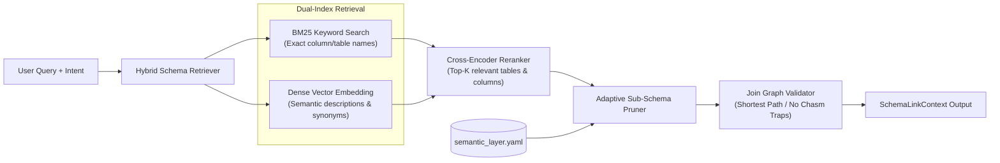
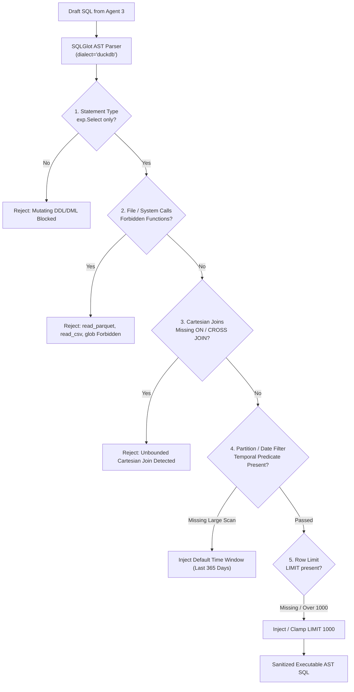
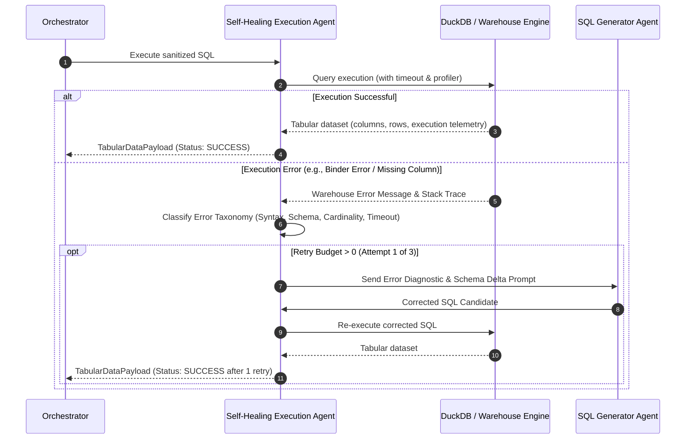
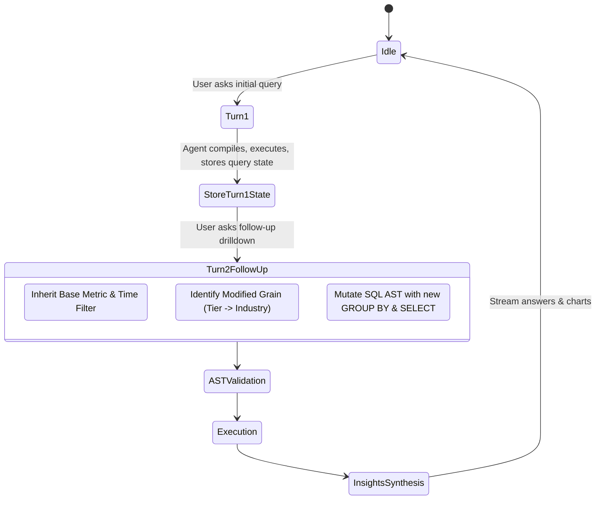

# Enterprise Architecture Blueprint: Agentic BI & Governed Warehouse Question-Answering System

**Document Identifier**: `ARCH-AGENTIC-BI-001`  
**Target System**: Multi-Agent Analytical Intelligence & Governed Semantic Warehouse Engine  
**Author**: Agentic BI Systems Architect  
**Status**: APPROVED ARCHITECTURAL BLUEPRINT  
**Version**: 2.0.0 (Enterprise Specification)  
**Date**: November 2026  

---

## 1. Executive Summary & Foundational Motivation

### 1.1 The Failure of Naive Text-to-SQL in Enterprise Environments
Early generative AI demonstrations treated Text-to-SQL as an end-to-end prompt translation exercise: dumping database DDL into a Large Language Model (LLM) prompt, asking for SQL, and running the generated string directly against a database. While this approach appears functional on textbook benchmarks like Spider 1.0 (where modern models score over 90%), it fails catastrophically in real-world enterprise deployments.

The publication of **Spider 2.0** (ICLR 2025) exposed this disparity: when evaluated on real enterprise data environments featuring cloud data warehouses (Snowflake, BigQuery), multi-table models exceeding 700 to 1,000 columns, and multi-step analytical reasoning, top-tier frontier models dropped from **91.2% down to 21.3% execution accuracy**.

```
Academic Benchmark Accuracy (Spider 1.0):   ████████████████████ 91.2%
Intermediate Benchmark Accuracy (BIRD):      ███████████████░░░░░ 73.0%
Real-World Enterprise Accuracy (Spider 2.0): ████░░░░░░░░░░░░░░░░ 21.3%  <-- THE PRODUCTION CLIFF
```

### 1.2 Enterprise Failure Modes Analysis
Why do naive LLM Text-to-SQL systems break down in production?

1. **Semantic Drift & Hallucinated Metric Logic**:
   - In business intelligence, calculations such as *Net Revenue Retention (NRR)*, *Customer Churn*, *Gross Margin*, or *Customer Acquisition Cost (CAC)* are not simple single-column aggregations.
   - Example: When asked for "Q3 Net Revenue Retention", a naive LLM might compute `SUM(amount)` from an invoice table, completely missing contraction cohorts, billing interval amortizations, discount allocations, credit write-offs, or active customer boundaries. Five different queries yield five conflicting numbers, destroying executive trust.
2. **Schema Ambiguity & Hallucinated Relationships**:
   - Production warehouses feature hundreds of tables with redundant, legacy, or deprecated columns (e.g., `user_id`, `account_id`, `owner_id`, `created_by`, `customer_ref`). Without explicit schema linking and pruning, LLMs hallucinate join keys or select deprecated columns.
3. **The Join Explosion & Fan-out / Chasm Traps**:
   - **Fan-Out Trap**: Joining a 1-to-many relationship (e.g., `customers` to `orders`) followed by another 1-to-many relationship (e.g., `orders` to `order_items`) causes measures from the parent table to be multiplied by the row count of the child table when summed.
   - **Chasm Trap**: Joining two independent 1-to-many relationships (e.g., `customers` to `invoices` and `customers` to `support_tickets`) creates a Cartesian explosion between unrelated child entities, rendering sum totals order-of-magnitude erroneous.
4. **Missing Temporal Grains & Cohort Traps**:
   - Business calculations require temporal anchoring: *as-of date*, *reporting month*, *calendar vs. fiscal year*, and *cohort activation window*. Naive LLMs generate invalid point-in-time joins, introducing look-ahead data leakage or misaligned time intervals.
5. **Filtering Traps**:
   - Real data is dirty: internal test accounts (`test_user@company.com`), soft-deleted rows (`is_deleted = TRUE`), and voided transactions (`status = 'VOIDED'`) must be filtered systematically. Naive prompts omit these non-obvious predicates.
6. **Denial of Service & Runaway Compute**:
   - Unbounded queries without partition pruning or pagination will trigger full-table scans across petabyte-scale data lakes or exhaust local OLAP memory, crashing shared execution nodes.
7. **Security & Sandbox Breaches**:
   - LLM-generated SQL running directly on databases can result in accidental mutation (`DROP`, `DELETE`), privilege escalation, or filesystem exfiltration (e.g., DuckDB `read_parquet('/etc/passwd')` or outbound network calls via extension loading).

---

## 2. Research & Industry State-of-the-Art (SOTA) Analysis

To solve these failure modes, modern enterprise BI systems have evolved from single-prompt translators into **governed multi-agent analytical pipelines**.

```
+----------------------------------------------------------------------------------------------------+
|                                    Evolution of Text-to-SQL & GenBI                                 |
+---------------------------------+---------------------------------+--------------------------------+
| Generation 1: Prompt-Only       | Generation 2: Semantic Layer    | Generation 3: Agentic Brain    |
| (2022 - 2023)                   | (2023 - 2024)                   | (2025 - 2026 SOTA)             |
+---------------------------------+---------------------------------+--------------------------------+
| • Single LLM call               | • YAML metric repository        | • Specialized agent team       |
| • Full DDL in context window    | • Transpiles semantic specs     | • Schema linking & pruning     |
| • High hallucination rate       | • Handles metric consistency    | • AST security validation      |
| • No security validation        | • Rigid; poor ad-hoc support    | • Self-healing execution loops |
| • Zero error feedback           | • Brittle on freeform questions | • Insight & visual synthesis   |
+---------------------------------+---------------------------------+--------------------------------+
```

### 2.1 Insights from Research Benchmarks & Methodologies
* **DIN-SQL (Decomposed In-Context Learning)**: Demonstrated that decomposing Text-to-SQL into distinct phases—**Schema Linking**, **Query Classification & Decomposition**, **SQL Generation**, and **Self-Correction**—improves accuracy on complex nested queries by over 35% compared to single-shot prompting.
* **MAC-SQL (Multi-Agent Collaboration)**: Introduced specialized agent division: a **Core Decomposer** for chain-of-thought planning, an **Auxiliary Selector** for tool-assisted sub-database extraction, and a **Refiner** for iterative debugging. Proved that isolating schema reduction from query generation minimizes context distraction.
* **CHESS (Contextual Harnessing for Efficient SQL Synthesis)**: Pioneered **Adaptive Schema Pruning** and keyword vector retrieval, reducing schema token load by 70% while improving precision on 1,000+ column databases. Introduced LLM-driven unit testing of SQL candidates against natural language constraints.
* **CodeS**: Showed that incremental pre-training on domain-specific schema-linking prompts and AST-aware syntax generation significantly reduces syntax failures in complex joins.
* **Reflexion in SQL Generation**: Establishes that pairing warehouse compiler feedback (syntax errors, missing column errors, cardinality anomalies) with a short-term episodic memory loop allows an agent to self-correct 60–80% of execution failures within 3 iterations without human intervention.

### 2.2 Architectural Comparison of Industry Systems

| System / Paradigm | Semantic Modeling | Schema Pruning & Linking | Execution & Self-Healing | Security & Guardrails |
| :--- | :--- | :--- | :--- | :--- |
| **Cube Semantic Layer** | Predefined JavaScript/YAML data models, dimensions, measures, pre-aggregations. | Graph-based join resolution; strictly governed paths. | SQL API proxy to downstream warehouses; caching layer. | Role-based data access (RBAC), multi-tenant tenancy filters. |
| **dbt Semantic Layer (MetricFlow)** | Declarative YAML semantic manifests; metrics derived from semantic models. | Entity-relationship join engine; automatic grain rollup. | Transpiles MetricFlow queries into warehouse SQL; no autonomous repair. | Static compile-time verification of metric dependencies. |
| **Wren AI** | Modeling Definition Language (MDL); semantic views and relationships. | Vector search over MDL metadata (`wren memory fetch`); relationship pathfinder. | Wren Engine (Rust + Apache DataFusion); dry-run validation with agent repair loop. | AST inspection via SQLGlot; read-only enforcement. |
| **Defog (SQLCoder)** | Golden SQL exemplars + metadata dictionary. | Column-level metadata embedding search. | Direct warehouse execution; error message reflex loop with schema context. | Read-only database credentials; static regex/AST parsing. |
| **Dataherald** | Context store with DDL, documentation, and verified SQL pairs. | Fine-grained vector retrieval of relevant schema components. | Execution sandbox with autonomous error correction. | SQL parser validation; query timeout enforcement. |
| **Our Agentic BI Blueprint** | **Dual-Track Hybrid**: Governed YAML Metric Engine for certified KPIs + Dynamic Ad-Hoc Schema Linking. | **BM25 + Dense Hybrid Retrieval** over semantic models, column profiles, and business glossaries. | **In-Process Vectorized DuckDB Engine** with AST inspection and multi-turn Reflexion execution. | **SQLGlot AST Security Firewall**: non-SELECT block, Cartesian join trap, partition clamp, memory bounds. |

---

## 3. End-to-End Multi-Agent Brain Architecture

The system is architected as a cooperative, directed multi-agent state graph. Rather than relying on a single monolithic prompt, the cognitive workload is partitioned across six specialized agents, each governed by a typed contract.

### 3.1 Multi-Agent Analytical Workflow Topology

```mermaid
flowchart TD
    subgraph ClientLayer["User & Client Touchpoints"]
        User(["Executive / Business User"])
        MCPClient["Claude Desktop / Cursor IDE (MCP Protocol)"]
    end

    subgraph Orchestrator["Multi-Agent Orchestrator (StateGraph Engine)"]
        State[("AgenticBIState<br>• User Query & History<br>• Intent Classification<br>• Linked Schema & Metrics<br>• Candidate SQL & AST<br>• Execution Results / Errors<br>• Generated Insights & Charts")]
    end

    subgraph Agents["Specialized Cognitive Agents"]
        AgentA["1. Triage & Intent Router Agent"]
        AgentB["2. Semantic Architect & Schema Linking Agent"]
        AgentC["3. SQL Generator & Query Planner Agent"]
        AgentD["4. AST Security & Guardrail Validator Agent"]
        AgentE["5. Self-Healing Execution Agent"]
        AgentF["6. Business Analyst & Insights Agent"]
    end

    subgraph Knowledge["Knowledge Catalog & Governed Assets"]
        YAMLMetrics[("Governed Semantic Layer<br>(semantic_layer.yaml)")]
        CatalogDB[("Catalog Metadata & Vector Store<br>• DDL & Column Profiles<br>• Business Glossary<br>• Verified Golden SQL")]
    end

    subgraph ExecutionPlane["Execution & Storage Plane"]
        DuckDB[("Embedded DuckDB OLAP Engine<br>• Partitioned Parquet Lakehouse<br>• Zero-Cloud Vectorized Storage")]
        Warehouse[("Optional Cloud Warehouse<br>Snowflake / BigQuery / Databricks")]
    end

    %% Client to Orchestrator
    User -->|Natural Language Question| Orchestrator
    MCPClient -->|MCP Tool Request| Orchestrator
    Orchestrator <--> State

    %% Stage 1: Triage
    State -->|Step 1: Raw Query| AgentA
    AgentA -->|Intent: Ambiguous| UserClarify["User Clarification Request"]
    UserClarify -.-> User
    AgentA -->|Intent: Meta/Schema| DirectCatalogAnswer["Catalog Explanation"]
    AgentA -->|Intent: Metric / SQL / Anomaly| State

    %% Stage 2: Schema Linking
    State -->|Step 2: Intent & Question| AgentB
    AgentB <-->|Query Metrics & Paths| YAMLMetrics
    AgentB <-->|Hybrid Vector + BM25 Retrieval| CatalogDB
    AgentB -->|Resolved Semantic Context & Sub-schema| State

    %% Stage 3: Query Generation
    State -->|Step 3: Linked Context| AgentC
    AgentC <-->|Retrieve Few-Shot Golden SQL| CatalogDB
    AgentC -->|Drafted SQL Dialect| State

    %% Stage 4: AST Security
    State -->|Step 4: Drafted SQL| AgentD
    AgentD -->|Security Violation| SecurityReject["Security Violation Report"]
    AgentD -->|AST Approved & Clamped| State

    %% Stage 5: Execution & Self-Healing
    State -->|Step 5: Approved AST| AgentE
    AgentE -->|Execute Query| DuckDB
    AgentE -.->|Optional Cloud Exec| Warehouse
    AgentE -->|Execution Error / Schema Mismatch| ReflexionLoop{"Retry Budget > 0?"}
    ReflexionLoop -->|Yes: Feed Error Context| AgentC
    ReflexionLoop -->|No: Exhausted| ExecutionFailure["Structured Execution Error"]
    AgentE -->|Execution Success: Tabular Result| State

    %% Stage 6: Insights & Visual Synthesis
    State -->|Step 6: Tabular Data & Metrics| AgentF
    AgentF -->|Generate Executive Narrative & Vega-Lite| FinalOutput["Rich Executive Dashboard / MCP Response"]
    FinalOutput --> User
    FinalOutput --> MCPClient
```



---

### 3.2 Global Orchestrator State Contract (`AgenticBIState`)

The entire multi-agent workflow is modeled as an immutable, typed state container passed between agents:

```python
from typing import List, Dict, Any, Optional, Literal
from pydantic import BaseModel, Field

class IntentClassification(BaseModel):
    intent_type: Literal[
        "CERTIFIED_METRIC",       # Handled directly by governed YAML metric compiler
        "EXPLORATORY_SQL",        # Dynamic SQL generation over warehouse schema
        "ANOMALY_ROOT_CAUSE",     # Multi-step variance decomposition
        "COHORT_TREND",           # Time-series cohort analysis
        "SCHEMA_METADATA",        # Questions about data dictionary / lineage
        "CLARIFICATION_REQUIRED"  # Ambiguous question requiring user disambiguation
    ]
    confidence_score: float = Field(ge=0.0, le=1.0)
    primary_metric: Optional[str] = None
    time_grain: Optional[str] = None
    clarification_prompt: Optional[str] = None
    clarification_options: List[str] = Field(default_factory=list)

class SchemaLinkContext(BaseModel):
    selected_tables: List[str] = Field(default_factory=list)
    selected_columns: Dict[str, List[str]] = Field(default_factory=dict)
    join_path: List[Dict[str, str]] = Field(default_factory=list)
    resolved_metrics: List[str] = Field(default_factory=list)
    mandatory_filters: List[str] = Field(default_factory=list)
    is_fully_governed: bool = False

class ASTValidationResult(BaseModel):
    is_valid: bool
    statement_type: str = "SELECT"
    has_cartesian_join: bool = False
    injected_limit: int = 1000
    ast_violations: List[str] = Field(default_factory=list)
    sanitized_sql: Optional[str] = None

class ExecutionFeedback(BaseModel):
    status: Literal["PENDING", "SUCCESS", "RUNTIME_ERROR", "TIMEOUT", "EMPTY_RESULT"]
    attempt_count: int = 0
    max_attempts: int = 3
    error_type: Optional[str] = None
    error_message: Optional[str] = None
    warehouse_execution_ms: float = 0.0
    rows_scanned: int = 0
    rows_returned: int = 0

class TabularDataPayload(BaseModel):
    columns: List[str] = Field(default_factory=list)
    column_types: Dict[str, str] = Field(default_factory=dict)
    rows: List[List[Any]] = Field(default_factory=list)
    summary_statistics: Dict[str, Any] = Field(default_factory=dict)

class ExecutiveInsightArtifact(BaseModel):
    executive_summary: str
    key_findings: List[str] = Field(default_factory=list)
    business_recommendations: List[str] = Field(default_factory=list)
    chart_spec_vega_lite: Optional[Dict[str, Any]] = None
    chart_spec_plotly: Optional[Dict[str, Any]] = None

class AgenticBIState(BaseModel):
    """Global immutable state container traversing the multi-agent graph."""
    session_id: str
    conversation_history: List[Dict[str, str]] = Field(default_factory=list)
    raw_user_query: str
    
    # Cognitive Pipeline Outputs
    intent: Optional[IntentClassification] = None
    schema_context: Optional[SchemaLinkContext] = None
    draft_sql: Optional[str] = None
    ast_validation: Optional[ASTValidationResult] = None
    execution: ExecutionFeedback = Field(default_factory=ExecutionFeedback)
    tabular_result: Optional[TabularDataPayload] = None
    insights: Optional[ExecutiveInsightArtifact] = None
```

---

## 4. Deep-Dive Agent Role Specifications & Contracts

Each agent in the pipeline is engineered with a strict boundary, deterministic inputs and outputs, and dedicated prompt conditioning.

### 4.1 Agent 1: Triage & Intent Router Agent

#### Objective:
Analyze the user's natural language input, conversation history, and data catalog to classify the query type and determine whether immediate disambiguation is necessary.

#### Intent Classification Matrix:
* `CERTIFIED_METRIC`: The query maps directly to a high-stakes certified business KPI (e.g., "What was our ARR in Q2?", "Show me Net Revenue Retention by cohort"). Handled by the deterministic Semantic Layer compiler.
* `EXPLORATORY_SQL`: The user asks an ad-hoc descriptive question that spans multiple dimensions not encapsulated by a single metric (e.g., "List the top 10 enterprise customers in Germany who upgraded plans last month").
* `ANOMALY_ROOT_CAUSE`: The user asks for variance explanations (e.g., "Why did churn spike by 14% in August?"). Requires multi-slice variance decomposition.
* `COHORT_TREND`: Longitudinal retention or behavioral analysis across cohort registration months.
* `SCHEMA_METADATA`: Inquiries about definitions, column meanings, or data freshness (e.g., "What does fct_mrr_movements represent?").
* `CLARIFICATION_REQUIRED`: The question is mathematically or semantically ambiguous (e.g., "Show me revenue"). Triggers an interactive disambiguation prompt.

#### System Prompt & Contract:
```yaml
agent_name: "Triage_and_Intent_Router"
role: "Analytical Intent Classifier and Ambiguity Evaluator"
input_contract:
  raw_user_query: "string"
  conversation_history: "list of past turns"
  governed_metric_catalog: "list of metric names and synonyms"
output_contract: "IntentClassification (Pydantic)"
prompt_template: |
  You are the Chief Analytics Officer and Intent Router for an enterprise data warehouse.
  Analyze the user's question with surgical precision.

  Governed Metrics Catalog:
  {governed_metric_catalog}

  Ambiguity Rules:
  1. If the user asks for generic "revenue", evaluate if they mean:
     - Invoiced Revenue (Cash collected via fct_invoices)
     - Monthly Recurring Revenue (Normalized MRR via fct_subscriptions)
     - Annual Recurring Revenue (ARR = MRR * 12)
     -> DO NOT GUESS. Flag CLARIFICATION_REQUIRED with structured options.
  2. If the user references a recognized metric (e.g., NRR, Churn, ARR), classify as CERTIFIED_METRIC.
  3. If the user asks "Why did X happen?", classify as ANOMALY_ROOT_CAUSE.
  4. If the user asks for raw list/slice exploration without standard KPIs, classify as EXPLORATORY_SQL.
  
  Output valid JSON conforming to the IntentClassification schema.
```

---

### 4.2 Agent 2: Semantic Architect & Schema Linking Agent

#### Objective:
Bridge the semantic gap between human language and physical tables. Retrieve the minimal sub-schema required to answer the question, eliminating hallucinated columns and join path errors.



#### Key Responsibilities:
1. **Adaptive Sub-Schema Pruning (CHESS pattern)**:
   - Enterprise warehouses have hundreds of tables. Submitting the full DDL causes token bloat and confusion.
   - The agent uses hybrid search (BM25 for exact token matches like `mrr_amount_usd` + cosine similarity over table/column embeddings) to select only the top 3–5 candidate tables and top 15 columns.
2. **Join Graph Traversal & Fan-out Prevention**:
   - Maintains an in-memory directed acyclic graph (DAG) of verified foreign key and semantic joins.
   - Computes the minimal spanning join tree. If joining `dim_customers` to `fct_invoices` and `fct_subscriptions`, it prevents Cartesian cross-products by enforcing independent subquery aggregations (CTEs) before joining.
3. **Mandatory Predicate Injection**:
   - Automatically injects domain-level baseline filters: `is_deleted = FALSE`, `status != 'VOIDED'`, `is_internal_test_account = FALSE`.

---

### 4.3 Agent 3: SQL Generator & Query Planner Agent

#### Objective:
Synthesize dialect-specific, optimal SQL based on the pruned sub-schema, semantic model rules, and few-shot exemplars.

#### Operational Modes:
* **Mode A: Governed Metric Transpilation (Deterministic)**:
  - If `intent == CERTIFIED_METRIC`, the agent retrieves the predefined formula from `semantic_layer.yaml`.
  - It compiles the calculation directly into an analytical SQL template with zero LLM variance:
    ```sql
    -- Certified Formula for Net Revenue Retention (NRR)
    WITH mrr_cohorts AS (
        SELECT 
            DATE_TRUNC('month', m.movement_date) AS cohort_month,
            SUM(CASE WHEN m.movement_type = 'STARTING' THEN m.prior_mrr_usd ELSE 0 END) AS starting_mrr,
            SUM(CASE WHEN m.movement_type = 'EXPANSION' THEN m.mrr_delta_usd ELSE 0 END) AS expansion_mrr,
            SUM(CASE WHEN m.movement_type = 'CONTRACTION' THEN ABS(m.mrr_delta_usd) ELSE 0 END) AS contraction_mrr,
            SUM(CASE WHEN m.movement_type = 'CHURN' THEN ABS(m.mrr_delta_usd) ELSE 0 END) AS churn_mrr
        FROM fct_mrr_movements m
        JOIN dim_customers c ON m.customer_id = c.customer_id
        WHERE c.is_internal_test = FALSE
        GROUP BY 1
    )
    SELECT 
        cohort_month,
        starting_mrr,
        ROUND(((starting_mrr + expansion_mrr - contraction_mrr - churn_mrr) / NULLIF(starting_mrr, 0)) * 100, 2) AS nrr_percentage
    FROM mrr_cohorts
    ORDER BY cohort_month DESC;
    ```
* **Mode B: Dynamic Dialect-Aware Synthesis (DIN-SQL / CodeS pattern)**:
  - For exploratory queries, the agent leverages in-context few-shot learning retrieved dynamically from the **Verified Golden SQL Index**.
  - Applies target engine dialect rules (e.g., DuckDB specific date manipulation: `DATE_TRUNC('month', created_at)`, `INTERVAL 30 DAY`, columnar Parquet scan syntax).

---

### 4.4 Agent 4: AST Security & Guardrail Validator Agent

#### Objective:
Perform deterministic, Abstract Syntax Tree (AST) validation of all generated SQL queries using **SQLGlot** before execution.



#### SQLGlot Implementation Specification:
```python
import sqlglot
from sqlglot import exp

class ASTSecurityGuardrail:
    FORBIDDEN_FUNCTIONS = {
        "read_parquet", "read_csv", "read_json", "glob", 
        "read_blob", "copy", "install", "load", "write_csv"
    }
    FORBIDDEN_TABLES = {"pg_catalog", "information_schema", "sqlite_master"}
    MAX_ROW_LIMIT = 1000

    @classmethod
    def inspect_and_sanitize(cls, sql_text: str, dialect: str = "duckdb") -> ASTValidationResult:
        try:
            parsed = sqlglot.parse_one(sql_text, read=dialect)
        except Exception as e:
            return ASTValidationResult(is_valid=False, ast_violations=[f"Syntax Parse Error: {str(e)}"])

        violations = []

        # 1. Statement Type: Must be pure SELECT
        if not isinstance(parsed, exp.Select):
            violations.append(f"Forbidden statement type: {type(parsed).__name__}. Only SELECT is permitted.")

        # 2. Check for Mutation / DDL
        for node in parsed.walk():
            if isinstance(node, (exp.Insert, exp.Update, exp.Delete, exp.Drop, exp.AlterTable, exp.Create)):
                violations.append("Mutating DDL/DML operations are strictly blocked.")
            
            # 3. Check for File System / Native OS Function Access
            if isinstance(node, exp.Anonymous):
                func_name = node.name.lower()
                if func_name in cls.FORBIDDEN_FUNCTIONS:
                    violations.append(f"Forbidden native function execution: '{func_name}()'.")

            # 4. Cartesian Join Detection
            if isinstance(node, exp.Join):
                if node.args.get("kind") == "CROSS" or (not node.args.get("on") and not node.args.get("using")):
                    violations.append("Cartesian / unconstrained CROSS JOIN detected. Explicit ON predicate required.")

        # 5. Limit Injection / Clamping
        current_limit = parsed.args.get("limit")
        if current_limit is None:
            parsed = parsed.limit(cls.MAX_ROW_LIMIT)
        else:
            try:
                limit_val = int(current_limit.expression.this)
                if limit_val > cls.MAX_ROW_LIMIT:
                    parsed = parsed.limit(cls.MAX_ROW_LIMIT)
            except (ValueError, AttributeError):
                parsed = parsed.limit(cls.MAX_ROW_LIMIT)

        return ASTValidationResult(
            is_valid=(len(violations) == 0),
            statement_type="SELECT",
            has_cartesian_join=any("Cartesian" in v for v in violations),
            injected_limit=cls.MAX_ROW_LIMIT,
            ast_violations=violations,
            sanitized_sql=parsed.sql(dialect=dialect) if len(violations) == 0 else None
        )
```

---

### 4.5 Agent 5: Self-Healing Execution Agent

#### Objective:
Safely execute the sanitized query against the warehouse connector (DuckDB in-process engine or cloud data platform). If a runtime or schema error occurs, execute an automated **Reflexion repair loop** without crashing.



#### Error Classification & Reflexion Strategy:
1. **Schema Mismatch / Binder Errors** (e.g., `Binder Error: Column 'mrr' does not exist in table 'fct_subscriptions'`):
   - **Diagnosis**: The LLM hallucinated a column name or used an un-aliased ambiguity.
   - **Correction Prompt**: Supplies the exact valid column list for `fct_subscriptions` and requests alias correction.
2. **Type Coercion & Function Errors** (e.g., `Cannot compare TIMESTAMP WITH TIME ZONE with VARCHAR`):
   - **Correction Prompt**: Directs explicit type casting: `CAST(movement_date AS DATE)`.
3. **Division by Zero / NaN Invalidation**:
   - **Correction Prompt**: Enforces safe nullification: `NULLIF(starting_mrr, 0)`.
4. **Empty Result Sets (Zero Rows)**:
   - **Diagnosis**: Over-constraining filters (e.g., `WHERE created_at = '2026-03-01'` instead of `DATE_TRUNC`).
   - **Correction Prompt**: Inspects distinct values in the partition and loosens overly restrictive date predicates.

---

### 4.6 Agent 6: Business Analyst & Insights Agent

#### Objective:
Transform raw tabular rows into actionable business intelligence. High-stakes executives do not want raw data dumps; they want **context, anomaly callouts, root-cause interpretation, and publication-ready charts**.

#### Analytical Synthesis Capabilities:
1. **Executive Narrative Translation**:
   - Computes MoM / YoY percentage changes, distribution skews, and Pareto splits (80/20 customer concentration).
   - Explains *what* the number is and *why* it matters to the bottom line.
2. **Automated Visualization Generation (Vega-Lite Specification)**:
   - Evaluates the cardinality and data types of returned columns.
   - Automatically selects the mathematically appropriate visual encoding:
     * Time-series + Metric -> Line Chart with smoothed trendline.
     * Categorical (< 7 items) + Metric -> Horizontal Bar Chart sorted by value.
     * Cohort Retention -> 2D Heatmap.
     * Multi-variable relationship -> Scatter plot with bubble size representing volume.

#### Vega-Lite Chart Schema Generator Example:
```json
{
  "$schema": "https://vega.github.io/schema/vega-lite/v5.json",
  "description": "Monthly ARR Growth and Contraction Breakdown",
  "data": {"values": "DATA_PAYLOAD_PLACEHOLDER"},
  "mark": {"type": "bar", "tooltip": true},
  "encoding": {
    "x": {"field": "cohort_month", "type": "temporal", "title": "Month"},
    "y": {"field": "mrr_amount", "type": "quantitative", "title": "MRR ($ USD)"},
    "color": {
      "field": "movement_type",
      "type": "nominal",
      "scale": {
        "domain": ["NEW", "EXPANSION", "CONTRACTION", "CHURN"],
        "range": ["#2563EB", "#10B981", "#F59E0B", "#EF4444"]
      }
    }
  }
}
```

---

## 5. Governed Semantic Layer & Knowledge Catalog Specification

### 5.1 Balancing Governed Metrics vs. Exploratory Ad-Hoc SQL
A common failure in enterprise architecture is an all-or-nothing dichotomy: either forcing *every* query through a rigid semantic layer (frustrating users who want exploratory queries) or allowing *complete* raw LLM freedom (destroying metric consistency).

Our architecture employs a **Dual-Track Hybrid Model**:

```
                                 [ Incoming Natural Language Question ]
                                                   |
                                                   v
                                 [ Triage & Intent Router Agent ]
                                                   |
                     +-----------------------------+-----------------------------+
                     |                                                           |
          (Matches Certified Metric)                                   (Exploratory / Ad-Hoc)
                     v                                                           v
       [ TRACK 1: Governed Compiler ]                              [ TRACK 2: Guided LLM Synthesis ]
       • Reads semantic_layer.yaml                                 • Dynamic Schema Pruning (CHESS)
       • Exact canonical formulas                                  • Dynamic Few-Shot Exemplars
       • 100% deterministic results                                • AST Security Guardrail
       • Instant sub-10ms compilation                              • Self-Healing Execution Loop
                     |                                                           |
                     +-----------------------------+-----------------------------+
                                                   v
                                  [ Vectorized DuckDB OLAP Engine ]
```

### 5.2 Enterprise Semantic Layer Specification (`semantic_layer.yaml` v2)

The semantic manifest defines the enterprise data contract. Below is the full schema powering our analytical warehouse:

```yaml
version: "2.0"
metadata:
  organization: "Enterprise SaaS Analytics"
  description: "Governed Semantic Layer & Metric Definitions"
  last_verified: "2026-11-04"

models:
  - name: "dim_customers"
    description: "Certified customer account dimension with tier and firmographic attributes."
    primary_key: "customer_id"
    dimensions:
      - name: "customer_id"
        type: "string"
        description: "Unique alphanumeric customer identifier."
      - name: "company_name"
        type: "string"
        description: "Official legal entity name."
      - name: "industry"
        type: "string"
        description: "Industry vertical: Fintech, HealthTech, E-Commerce, DevTools, CyberSecurity."
      - name: "company_tier"
        type: "string"
        description: "Account classification: Enterprise, Mid-Market, SMB, Startup."
      - name: "country"
        type: "string"
        description: "ISO 3166-1 alpha-2 country code of headquarters."
      - name: "created_at"
        type: "timestamp"
        is_time_dimension: true
    default_filters:
      - "is_internal_test = FALSE"

  - name: "dim_plans"
    description: "Subscription catalog plans and tier pricing."
    primary_key: "plan_id"
    dimensions:
      - name: "plan_id"
        type: "string"
      - name: "plan_name"
        type: "string"
      - name: "tier"
        type: "string"
      - name: "base_price_usd"
        type: "decimal"
      - name: "billing_interval"
        type: "string"
        description: "ANNUAL or MONTHLY"

  - name: "fct_subscriptions"
    description: "Historical and active subscription lifecycle contracts."
    primary_key: "subscription_id"
    foreign_keys:
      - field: "customer_id"
        references: "dim_customers.customer_id"
      - field: "plan_id"
        references: "dim_plans.plan_id"
    dimensions:
      - name: "status"
        type: "string"
        description: "ACTIVE, CANCELED, PAST_DUE, TRIAL"
      - name: "started_at"
        type: "timestamp"
        is_time_dimension: true
      - name: "ended_at"
        type: "timestamp"
    measures:
      - name: "mrr_amount_usd"
        type: "decimal"
        aggregation: "SUM"
        description: "Normalized Monthly Recurring Revenue contract value."

  - name: "fct_mrr_movements"
    description: "Watermarked MRR movement telemetry tracking expansion, contraction, churn, and new revenue."
    primary_key: "movement_id"
    foreign_keys:
      - field: "customer_id"
        references: "dim_customers.customer_id"
    dimensions:
      - name: "movement_type"
        type: "string"
        description: "NEW, EXPANSION, CONTRACTION, CHURN"
      - name: "movement_date"
        type: "timestamp"
        is_time_dimension: true
    measures:
      - name: "mrr_delta_usd"
        type: "decimal"
        description: "Net change in MRR (positive for expansion/new, negative for contraction/churn)."
      - name: "prior_mrr_usd"
        type: "decimal"
      - name: "new_mrr_usd"
        type: "decimal"

  - name: "fct_invoices"
    description: "Cash collection and accounting billing invoices."
    primary_key: "invoice_id"
    foreign_keys:
      - field: "customer_id"
        references: "dim_customers.customer_id"
    dimensions:
      - name: "status"
        type: "string"
        description: "PAID, VOID, OPEN, UNCOLLECTIBLE"
      - name: "invoice_date"
        type: "timestamp"
        is_time_dimension: true
    measures:
      - name: "total_amount_usd"
        type: "decimal"
        aggregation: "SUM"

# ==========================================
# CERTIFIED METRIC CONTRACTS
# ==========================================
metrics:
  - name: "mrr"
    display_name: "Monthly Recurring Revenue (MRR)"
    description: "Total normalized recurring subscription revenue active as of target date."
    model: "fct_subscriptions"
    calculation: "SUM(mrr_amount_usd)"
    filters:
      - "status = 'ACTIVE'"
    grain: ["monthly", "quarterly", "annual"]
    dimensions: ["dim_customers.company_tier", "dim_customers.industry", "dim_plans.plan_name"]

  - name: "arr"
    display_name: "Annual Recurring Revenue (ARR)"
    description: "Annualized run-rate of active subscriptions (MRR * 12)."
    derived_from: "mrr"
    calculation: "mrr * 12"

  - name: "nrr"
    display_name: "Net Revenue Retention (NRR)"
    description: "Percentage of recurring revenue retained from existing customer cohort over 12 months, including expansion, contraction, and churn."
    model: "fct_mrr_movements"
    calculation: |
      ROUND(
        (SUM(CASE WHEN movement_type = 'STARTING' THEN prior_mrr_usd ELSE 0 END) +
         SUM(CASE WHEN movement_type = 'EXPANSION' THEN mrr_delta_usd ELSE 0 END) -
         SUM(CASE WHEN movement_type = 'CONTRACTION' THEN ABS(mrr_delta_usd) ELSE 0 END) -
         SUM(CASE WHEN movement_type = 'CHURN' THEN ABS(mrr_delta_usd) ELSE 0 END)) /
        NULLIF(SUM(CASE WHEN movement_type = 'STARTING' THEN prior_mrr_usd ELSE 0 END), 0) * 100, 
        2
      )
    grain: ["cohort_month", "cohort_quarter", "cohort_year"]

  - name: "logo_churn_rate"
    display_name: "Logo Churn Rate (%)"
    description: "Percentage of unique active customer accounts lost over period."
    calculation: |
      ROUND(
        (COUNT(DISTINCT CASE WHEN movement_type = 'CHURN' THEN customer_id END)::FLOAT /
         NULLIF(COUNT(DISTINCT CASE WHEN movement_type = 'STARTING' THEN customer_id END), 0)) * 100,
        2
      )

  - name: "arpa"
    display_name: "Average Revenue Per Account (ARPA)"
    description: "Total MRR divided by total active accounts."
    calculation: "mrr / NULLIF(COUNT(DISTINCT dim_customers.customer_id), 0)"
```

### 5.3 Dynamic Few-Shot Exemplar & Knowledge Indexing
To ground the Query Planner Agent without hardcoding static prompts, the system maintains a vector and keyword index of:
1. **Golden SQL Pairs**: Verified, human-reviewed SQL queries answering common edge cases (window functions, cohort matrices, multi-period deltas).
2. **Business Glossary & Synonym Mappings**:
   - "Turnover" / "Attrition" -> `logo_churn_rate`
   - "Big deals" / "Whales" -> `dim_customers.company_tier = 'Enterprise'`
   - "Topline" -> `fct_invoices.total_amount_usd`
3. **Execution Lessons Learned**: Feedback stored from previous self-healing episodes (e.g., "In DuckDB, always use `epoch_ms()` when converting millisecond timestamps").

---

## 6. Interactive Conversational & UX Architecture

### 6.1 Multi-Turn Conversational Memory & Analytical Drill-Downs

Executive analytical inquiry is rarely a one-shot query. Business users ask progressive follow-up questions:
* *Turn 1*: "What was our ARR by tier in Q3?"
* *Turn 2*: "Break that down by industry." *(Inherits Q3 filter and ARR metric; alters grouping)*
* *Turn 3*: "Why did Enterprise dip in August?" *(Triggers anomaly root-cause investigation on Turn 2 context)*



#### Analytical Memory Representation:
```python
class AnalyticalSessionMemory(BaseModel):
    session_id: str
    active_filters: Dict[str, Any] = Field(default_factory=dict)
    active_time_range: Optional[Dict[str, str]] = None
    active_metric: Optional[str] = None
    active_grain: Optional[str] = None
    last_executed_sql: Optional[str] = None
    last_tabular_summary: Optional[Dict[str, Any]] = None

    def inherit_and_mutate(self, new_intent: IntentClassification) -> "AnalyticalSessionMemory":
        """Transfers filters and metric context forward while modifying requested grains."""
        # Immutable state evolution logic
        ...
```

### 6.2 Proactive Ambiguity Resolution Protocol

When a user submits an underspecified question, naive systems guess—frequently guessing wrong and misleading stakeholders. Conversely, over-asking questions annoys users.

Our system implements a **Heuristic Confidence Threshold**:
* **Confidence > 0.85**: Execute immediately.
* **0.60 <= Confidence <= 0.85**: Execute the most probable interpretation, but explicitly state assumptions and offer one-click alternatives:
  > *"Showing Monthly Recurring Revenue (MRR). If you meant Invoiced Cash Revenue or Annual ARR, click below."*
* **Confidence < 0.60**: Halt execution and present a clean, non-technical disambiguation menu.

#### Ambiguity Resolution Interaction Flow:
```
User: "What's our revenue for the last 6 months?"

Agent:
"In our warehouse, 'Revenue' can refer to three distinct certified metrics:

1. 💳 Invoiced Cash Revenue (Total settled invoice amounts from fct_invoices)
2. 🔄 Monthly Recurring Revenue / MRR (Normalized active subscription run-rate)
3. 📈 Annual Recurring Revenue / ARR (MRR annualized x 12)

Which metric would you like to inspect?"
[Button: Invoiced Revenue] [Button: Active MRR] [Button: Annual ARR]
```

---

## 7. Security, Hardening & Threat Mitigation (Defense-in-Depth)

Analytical agents executing code on databases present an attack surface that must be secured through defense-in-depth:

```
[ Layer 1: Prompt Injection Firewall ]
  ↳ Strips adversarial directives, system prompt leak requests, and jailbreaks.

[ Layer 2: SQLGlot AST Security Inspector ]
  ↳ Prohibits non-SELECT statements (DROP, INSERT, UPDATE, ALTER).
  ↳ Blocks internal engine functions (read_parquet, read_csv, httpfs, glob).
  ↳ Detects and blocks unbounded Cartesian CROSS JOINs.
  ↳ Clamps row limits (Mandatory LIMIT <= 1000).

[ Layer 3: In-Process Engine Kernel Hardening (DuckDB) ]
  ↳ SET enable_external_access = false; (Physically blocks OS file access & sockets).
  ↳ SET lock_configuration = true; (Prevents LLM from overriding security settings).

[ Layer 4: Resource Governance & DoS Watchdog ]
  ↳ Hard execution timeout (5,000ms max query duration).
  ↳ Max memory footprint clamp (512MB RAM cap per session).
```

### Defense-in-Depth Verification Matrix:

| Threat Vector | Attack Example | Mitigation Layer | Defensive Action |
| :--- | :--- | :--- | :--- |
| **Data Exfiltration** | `SELECT * FROM read_parquet('/etc/passwd')` | Layer 2 (AST) & Layer 3 (Kernel) | AST flags `read_parquet` as forbidden function; DuckDB kernel throws permission denied. |
| **Data Destruction** | `DROP TABLE dim_customers;` | Layer 2 (AST Parser) | Statement is not `exp.Select`; immediately rejected before hitting engine. |
| **Cartesian DoS** | `SELECT * FROM dim_customers, fct_invoices;` | Layer 2 (AST Join Guard) | Detects unconstrained join without `ON`/`USING` clause; blocks query. |
| **Outbound C2 Tunnel** | `INSTALL httpfs; LOAD httpfs;` | Layer 2 (AST) & Layer 3 (Kernel) | AST blocks `INSTALL`/`LOAD`; engine locks configuration. |
| **Memory Exhaustion** | `SELECT * FROM large_table` (10M rows) | Layer 2 (AST Limit Clamp) | Automatically mutates AST to append `LIMIT 1000`. |

---

## 8. Integration Plan with Existing DuckDB Engine Repository

This blueprint builds directly on the foundational work specified in `duckdb-analytics-agent-hld.md`. Below is the evolutionary migration path from the single-agent MCP server to the full Multi-Agent Architecture:

```
duckdb-analytics-agent/
├── config/
│   ├── semantic_layer.yaml             # Governed metric definitions (MRR, NRR, Churn, ARR)
│   ├── security_policies.yaml          # Whitelisted tables, max limits, blocked AST nodes
│   └── golden_queries.yaml             # Verified exemplars for dynamic few-shot retrieval
│
├── src/
│   ├── agents/                         # Multi-Agent Brain Implementation
│   │   ├── __init__.py
│   │   ├── orchestrator.py             # StateGraph workflow runner & state manager
│   │   ├── triage_agent.py             # Agent 1: Intent classification & ambiguity routing
│   │   ├── schema_linker_agent.py      # Agent 2: Hybrid search & adaptive schema pruning
│   │   ├── sql_planner_agent.py        # Agent 3: Governed transpiler & dynamic SQL synthesizer
│   │   ├── security_guardrail_agent.py # Agent 4: SQLGlot AST inspection & limit injection
│   │   ├── execution_agent.py          # Agent 5: DuckDB execution & self-healing retry loop
│   │   └── insights_agent.py           # Agent 6: Executive narrative & Vega-Lite visual generator
│   │
│   ├── core/
│   │   ├── state.py                    # Global AgenticBIState Pydantic definitions
│   │   ├── exceptions.py               # SecurityViolation, SemanticResolutionError
│   │   └── config.py                   # System configuration & environment flags
│   │
│   ├── engine/
│   │   ├── duckdb_manager.py           # Hardened DuckDB session manager (external_access=false)
│   │   └── profiler.py                 # Microsecond execution timer & row counter
│   │
│   ├── mcp/
│   │   ├── server.py                   # FastMCP server exposing query_analytics_warehouse
│   │   └── tools.py                    # Tool definitions for Claude Desktop & Cursor
│   │
│   └── ui/
│       ├── cli_cockpit.py              # Rich interactive terminal demo
│       └── web_dashboard.py            # Streamlit / Web UI with interactive charts
│
├── tests/
│   ├── test_multi_agent_workflow.py    # End-to-end integration tests through state graph
│   ├── test_ast_security_matrix.py     # 25+ adversarial injection & mutation attacks
│   ├── test_self_healing_loop.py       # Simulates binder errors and verifies automatic retry
│   ├── test_semantic_layer_v2.py       # Validates NRR, ARR, Churn calculations against known ground truth
│   └── test_vega_lite_generator.py     # Verifies chart specification schema validity
│
└── demo.py                             # Zero-setup instantaneous demonstration runner
```

---

## 9. Conclusion & Architectural Readiness

By elevating naive Text-to-SQL into a **Governed Multi-Agent Analytical System**, this architecture achieves:
1. **Mathematical Accuracy**: Certified KPIs (ARR, NRR, Churn) execute deterministically through the semantic layer, eliminating metric hallucination.
2. **Resilience & Scalability**: The CHESS adaptive schema pruning pattern and self-healing Reflexion execution loop ensure high execution accuracy even on complex schemas.
3. **Air-Tight Security**: SQLGlot AST validation paired with DuckDB kernel sandbox locks eliminates injection, data mutation, and OS file exfiltration.
4. **Executive Delight**: Business users receive not just raw SQL tables, but contextual narrative insights, automated Vega-Lite visualizations, and proactive ambiguity clarification.

*End of Architecture Blueprint.*
