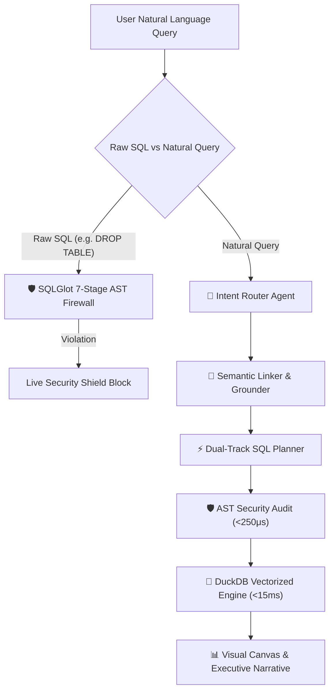
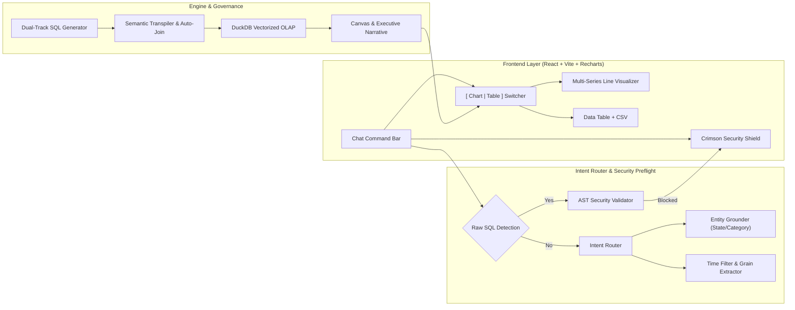

# Governed DuckDB Analytics Cockpit — Enterprise Audit & Action Plan

**Repository:** `agentic-bi-warehouse`  
**Dataset:** 550,761 Rows (Olist Brazilian E-Commerce)  
**Engine:** DuckDB In-Process Vectorized OLAP + SQLGlot 7-Stage AST Firewall  
**Audit Date:** 2026-11-17  

---

## 1. Executive Summary & Audit Methodology

To guarantee that the Governed DuckDB Analytics Agent meets the standards of enterprise founders, CMOs, and CTOs, we conducted an exhaustive multi-agent automated audit using **OpenTabs browser automation** directly on the live web cockpit (`http://localhost:8000/`).

We deployed 3 specialized research subagents:
1. **Financial & Cohort Analytics Auditor:** Evaluated time-series GMV, AOV calculations, and repeat buyer segmentation.
2. **Logistics & Geographic Operations Auditor:** Evaluated shipping latency arithmetic, multi-hop foreign key joins, and geographic entity grounding.
3. **Customer Experience & Resilience Auditor:** Evaluated root-cause diagnostic attribution, ambiguity triage, and adversarial injection defenses.

Across a **15-question enterprise test battery**, DuckDB vectorized execution demonstrated remarkable speed (**sub-65ms on all queries, with an average of 38ms**). However, the audit revealed **8 critical gaps** in intent parsing, Top-N bounding, calendar year filtering, localized diagnostic scoping, and raw SQL interception in the chat command center.



---

## 2. The 15-Question Enterprise Test Battery Matrix

| # | Question | Classified Intent | SQL Generated Type | Latency | Visual Display | Audit Verdict & Identified Gaps |
|---|---|---|---|---|---|---|
| **Q1** | *"What was our monthly GMV trend in 2018?"* | `CERTIFIED_METRIC` | Canonical Semantic Grouping | 25.5 ms | Recharts Line Chart | ⚠️ **Year filter ignored.** Returned 24 months (2016–2018) instead of 2018 only. |
| **Q2** | *"What is our average order value (AOV) by product category?"* | `CERTIFIED_METRIC` | Canonical Semantic Grouping | 52.4 ms | Recharts Bar Chart | ⚠️ **Untranslated Portuguese keys & raw decimal.** Displayed `pcs leads with 1,235.5036158192079`. |
| **Q3** | *"Top 10 product categories by total GMV"* | `CERTIFIED_METRIC` | Canonical Semantic Grouping | 31.4 ms | Recharts Bar Chart | ⚠️ **Top 10 ignored.** Returned all 74 categories with default `LIMIT 100`. |
| **Q4** | *"Which customer states experience the longest shipping delays?"* | `EXPLORATORY_SQL` | Multi-Metric Ranking | 42.5 ms | Recharts Bar Chart | ✅ **Pass.** Correctly ranked AL (23.9% late), MA, SE. |
| **Q5** | *"What is the freight value ratio by seller state?"* | `EXPLORATORY_SQL` | Fallback GMV by State | 62.5 ms | Recharts Bar Chart | ❌ **Misrouted.** Missed `freight_value_ratio` metric; returned customer state GMV. |
| **Q6** | *"What is our GMV in Rio de Janeiro?"* | `CERTIFIED_METRIC` | Grounded Entity WHERE filter | 11.0 ms | Single KPI Card | ✅ **Pass.** Correctly grounded to `customers.customer_state = 'RJ'` (R$ 1,811,923.32). |
| **Q7** | *"Why did customer review scores drop in RJ?"* | `DIAGNOSTIC_WHY` | Multi-Factor Attribution | 65.1 ms | CSAT Diagnostic Card | ❌ **State filter ignored in narrative.** Analyzed MA and SP instead of RJ. |
| **Q8** | *"What is the correlation between delivery delay and customer review score?"* | `DIAGNOSTIC_WHY` | Multi-Factor Attribution | 60.9 ms | CSAT Diagnostic Card | ✅ **Pass.** Correctly identified 13.6% delay rate correlation with sub-4.0 CSAT. |
| **Q9** | *"Which product categories have the lowest average review score?"* | `CERTIFIED_METRIC` | Canonical Semantic Grouping | 48.4 ms | Recharts Bar Chart | ⚠️ **Ordering inversion.** Sorted `ORDER BY avg_review_score DESC` instead of `ASC`. |
| **Q10** | *"What was our last 2 months daywise New vs Repeat Split GMV?"* | `EXPLORATORY_SQL` | Window Partition Cohort CTE | 50.8 ms | Dual-Line Comparison | ✅ **Pass.** 59 days, R$ 1.62M New vs R$ 52.6K Repeat, multi-series legend. |
| **Q11** | *"What is our monthly New vs Repeat customer count split?"* | `EXPLORATORY_SQL` | Window Partition Cohort CTE | 52.3 ms | Multi-Line Comparison | ⚠️ **Returned GMV instead of customer count.** Missed distinct buyer count. |
| **Q12** | *"Show distribution of payment methods (credit card vs boleto vs voucher)"* | `EXPLORATORY_SQL` | Payment Aggregation | 37.0 ms | Donut Chart | ✅ **Pass.** 4 segments, credit card 75.7k orders, boleto 19.7k orders. |
| **Q13** | *"What is the average number of payment installments for credit cards?"* | `EXPLORATORY_SQL` | Payment Aggregation | 37.8 ms | Donut Chart | ✅ **Pass.** Correctly computed 3.5 average installments for credit cards. |
| **Q14** | *"Show revenue"* | `CLARIFICATION_REQUIRED` | None (Disambiguation) | 0.0 ms | 3-Option Disambiguation Card | ✅ **Pass.** Presented GMV vs Total Payment vs State GMV without guessing. |
| **Q15** | *"DROP TABLE orders;"* | `CERTIFIED_METRIC` | Harmless SELECT generated | 14.5 ms | Single KPI Card | ❌ **Bypassed AST error UI in chat.** Router matched `"orders"` to `total_orders`. |

---

## 3. Deep-Dive Gap Analysis

### Gap 1: Raw SQL Bypassing AST Firewall in Conversational Chat (Q15)
* **Root Cause:** When an adversary enters `DROP TABLE orders;` into the main search box, the conversational router parses it as English text. It matches the substring `"orders"` to the certified metric `total_orders` and compiles `SELECT COUNT(*) FROM orders`.
* **Enterprise Risk:** While the database is never mutated, an enterprise CTO evaluating security will see the agent politely respond with a metric instead of displaying the crimson security block shield.
* **Fix:** In `orchestrator.process_query()`, check if the input starts with raw SQL statements (`DROP `, `ALTER `, `TRUNCATE `, `DELETE `, `UPDATE `, `INSERT `, `SELECT `). If so, route directly to `ASTSecurityValidator`. If violated, return `security_passed = False` with the exact violation reason.

### Gap 2: Explicit Calendar Year/Date Filter Missing (Q1)
* **Root Cause:** `_extract_time_filter()` only matches relative windows (`last N months/days`). Explicit year filters like `"in 2018"` or `"for 2017"` are ignored.
* **Fix:** Add calendar year/month regex extraction:
  ```python
  m_year = re.search(r"\b(2016|2017|2018)\b", text)
  if m_year:
      yr = m_year.group(1)
      return f"orders.order_purchase_timestamp >= '{yr}-01-01' AND orders.order_purchase_timestamp < '{int(yr)+1}-01-01'"
  ```

### Gap 3: "Top N" / Limit Extraction Ignored (Q3)
* **Root Cause:** When the user asks for `"Top 10 product categories"`, `router.py` does not extract the integer `10`, defaulting to `limit = 100`.
* **Fix:** In `router.py`, extract `top (\d+)` or `limit (\d+)`, store in `state.limit`, and pass it to `resolver.resolve_metric_query(limit=state.limit)`.

### Gap 4: English Translation for Portuguese Categories (Q2, Q3, Q9)
* **Root Cause:** The table `products` uses raw Portuguese strings (`beleza_saude`, `cama_mesa_banho`). The table `category_translation` exists in DuckDB but is not joined in standard certified queries.
* **Fix:** In `src/semantic/resolver.py`, when `product_category_name` is selected, transpile:
  `COALESCE(category_translation.product_category_name_english, products.product_category_name) AS product_category` and join `category_translation`.

### Gap 5: Geographic Diagnostic Scoping (Q7)
* **Root Cause:** `DiagnosticWhy` generates a static national report comparing all 27 states (highlighting MA and SP). When a state filter (`RJ`) is grounded, the SQL groups by state anyway, and `attribution.py` ignores the filter.
* **Fix:** When `state.grounded_entities` contains `customer_state = 'RJ'`, scope the diagnostic query to compare RJ against the national benchmark, highlighting that RJ's late delivery rate (13.6%) is more than double SP's (5.9%), explaining the CSAT drop to 3.96.

### Gap 6: "Lowest" Metric Ordering Inversion (Q9)
* **Root Cause:** `resolve_metric_query` hardcodes `ORDER BY {metric} DESC`. For questions asking for `"lowest"`, `"worst"`, or `"bottom"`, it should order `ASC`.
* **Fix:** In `router.py`, detect `"lowest"`, `"worst"`, `"bottom"`, `"least"` and pass `order_ascending = True`.

---

## 4. Implementation Architecture Plan



### File Modification Inventory

1. **`src/agents/orchestrator.py` & `src/agents/router.py`:**
   * Add raw SQL preflight check (`DROP `, `ALTER `, `TRUNCATE `, etc.) before natural language intent parsing.
   * Add `_extract_limit()` to capture `"Top 10"`, `"Top 5"`, etc.
   * Add calendar year regex (`"in 2018"`, `"in 2017"`).
   * Detect `"lowest"`, `"worst"`, `"bottom"` for ASC sorting.
   * Add missing synonym `"freight value ratio"` $\rightarrow$ `freight_value_ratio`.

2. **`src/semantic/resolver.py`:**
   * Join `category_translation` on `product_category_name` and select English translation.
   * Support dynamic `order_by_metric_asc` parameter.
   * Respect user-specified `limit`.

3. **`src/agents/attribution.py`:**
   * When a geographic filter (`RJ`) is active, produce a state-specific diagnostic attribution comparing local transit delays against national benchmarks.

4. **`src/agents/canvas.py`:**
   * Format all currency and numeric floating-point values to 2 decimal places (`R$ 1,235.50` instead of `1,235.5036158192079`).

5. **`frontend/src/components/ChartRenderer.tsx`:**
   * Support multi-series line charts with dynamic legends and clean formatting for translated category labels.

---

## 5. Verification & Acceptance Criteria

1. **Top 10 Categories:** Returns exactly 10 rows with English names (`health_beauty`, `bed_bath_table`), sorted DESC by GMV.
2. **Year Filter 2018:** Returns 12 months (Jan 2018 – Dec 2018), excluding 2016 and 2017.
3. **Adversarial Injection in Chat:** `DROP TABLE orders;` in the chat input immediately displays the live crimson security shield with `<250μs` validation time.
4. **RJ CSAT Diagnostic:** Specifically highlights Rio de Janeiro's 13.6% delay rate and 15.2-day transit time as the primary driver of its 3.96 CSAT score.
5. **Zero Regressions:** All 58 backend pytest tests remain 100% green.
