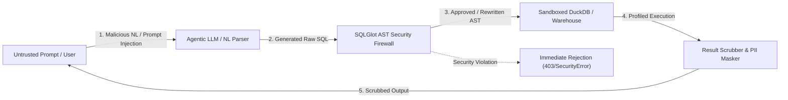
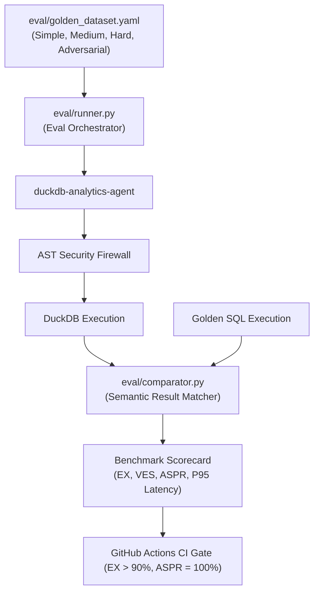
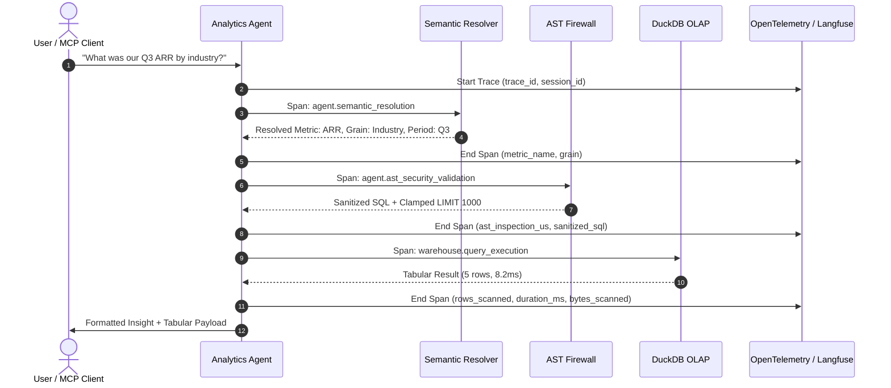
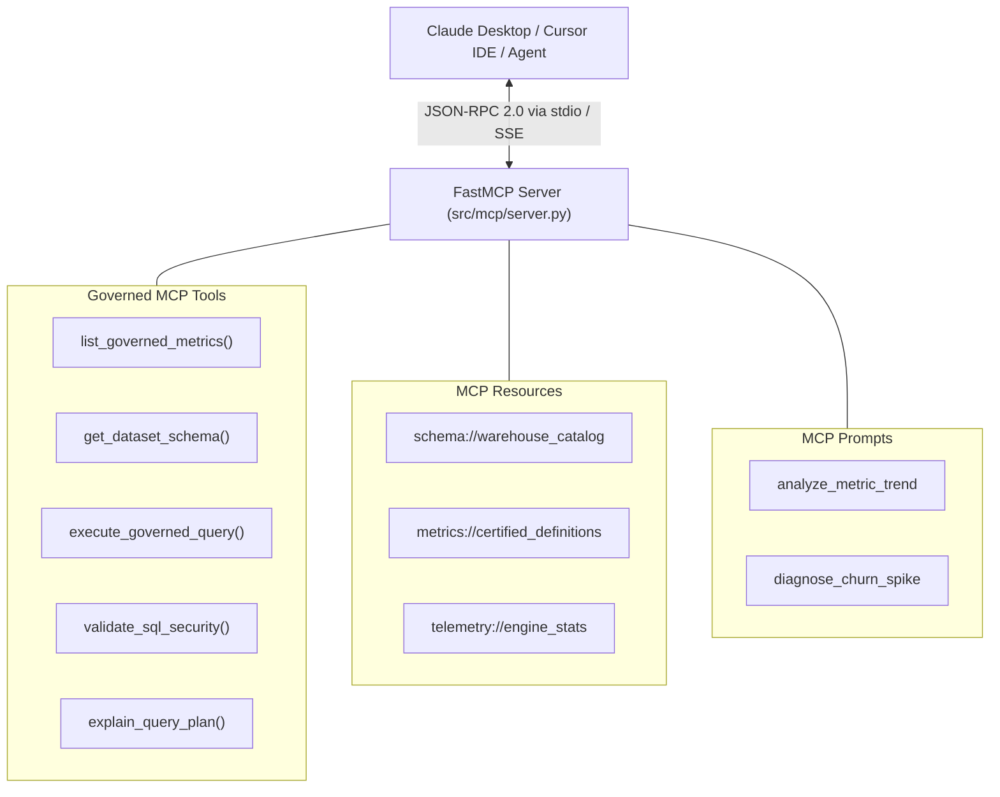

# Enterprise Architecture Blueprint: Security, Evaluation, Observability & Developer Experience (DX)

**Document Identifier**: `ARCH-SEC-EVAL-001`  
**System Target**: Agentic BI & Warehouse Question-Answering Engine (`duckdb-analytics-agent`)  
**Author**: Security, Evaluation & Developer Experience Architect  
**Status**: APPROVED FOR IMPLEMENTATION  
**Dialects Covered**: DuckDB (Default In-Process OLAP), Snowflake, BigQuery, Databricks, PostgreSQL  
**Last Updated**: November 4, 2026  

---

## 1. Executive Architectural Framing

Modern enterprise data architectures are transitioning from passive dashboards to autonomous and semi-autonomous AI agents capable of answering complex analytical questions from enterprise data warehouses. While LLM-driven Text-to-SQL holds immense promise, naive implementations deployed in enterprise environments fail catastrophically across four critical dimensions:

1. **Security Vulnerabilities**: Naive Text-to-SQL provides unconstrained prompt-to-database execution. Malicious users or jailbroken prompts exploit SQL injection, multi-statement stacking, out-of-bounds file system traversal (`read_parquet('/etc/passwd')`), network exfiltration via warehouse extensions, and denial-of-service Cartesian joins.
2. **Semantic & Business Hallucination**: Foundation models lack business context. When asked for *"Net Revenue Retention (NRR)"* or *"Gross Margin"*, models hallucinate arbitrary column sums without honoring refunds, contraction cohorts, or recognized revenue rules. Academic benchmarks show execution accuracy dropping from **91.2% on toy schemas (Spider 1.0)** to **21.3% on enterprise warehouse pipelines (Spider 2.0)**.
3. **Observability Blind Spots**: When an analytical query yields an incorrect or slow result, enterprise operations teams cannot inspect the internal reasoning trail (intent parsing $\rightarrow$ schema linking $\rightarrow$ metric compilation $\rightarrow$ AST validation $\rightarrow$ warehouse execution $\rightarrow$ insight synthesis).
4. **Poor Developer Experience (DX) & Evaluation**: Setting up enterprise warehouses requires days of IAM credentials, cloud billing configurations, and network tunnels. Evaluators and engineers require an instant, zero-credential local testing loop backed by standardized Model Context Protocol (MCP) tooling and an interactive cockpit.

This document establishes the production-grade architecture for **Security Hardening**, **Evaluation & Benchmarking**, **Distributed Tracing & Observability**, and **Developer Experience (DX)** for the `duckdb-analytics-agent` system.

---

## 2. Enterprise Security & Deepened STRIDE Threat Model

### 2.1 Threat Actor Archetypes & Injection Vectors
Enterprise AI analytics agents operate in hostile multi-tenant environments where queries can originate from internal business users, automated downstream agents, or untrusted external prompt inputs.



The system defends against three specific threat actors:
1. **The External Adversary (Indirect Prompt Injection)**: Injects adversarial instructions into source data (e.g., customer company names like `Acme'; DROP TABLE fct_invoices;--`) designed to manipulate subsequent analytical agent runs.
2. **The Malicious Internal Operator (Direct Jailbreaking)**: Prompts the agent to dump raw sensitive columns (`SELECT email, ssn, password_hash FROM dim_customers`) or traverse internal host storage.
3. **The Unintentional Saboteur (Runaway Resource Exhaustion)**: Requests unbounded cross-dimensional slicing that generates multi-table Cartesian joins or gigabyte-scale scans, starving compute resources.

---

### 2.2 Deepened STRIDE Threat Matrix

| STRIDE Category | Specific Attack Vector | Target Surface (DuckDB vs Cloud Warehouses) | Technical Severity | Mitigation Layer |
| :--- | :--- | :--- | :--- | :--- |
| **Spoofing** | Tenant context spoofing; overriding session tenant ID via comment tricks or subqueries. | In-Process: Shared connection memory.<br>Cloud: Role assumption, search path spoofing. | **CRITICAL** | Parameterized tenant filters injected at the AST level; immutable session context. |
| **Tampering** | Multi-statement injection (`SELECT 1; DROP TABLE...`); DDL/DML mutations (`UPDATE`, `DELETE`, `ALTER`, `TRUNCATE`). | In-Process: Local Parquet / DuckDB file corruption.<br>Cloud: Mutating production tables, altering warehouse credits. | **CRITICAL** | AST statement whitelisting (Only `exp.Select` permitted); multi-statement token rejection. |
| **Repudiation** | Unlogged ad-hoc executions; unprofiled data extraction. | Both: Lack of audit trails for AI-generated SQL execution. | **HIGH** | OpenTelemetry structured JSONL audit logs recording full AST, normalized query hash, caller ID, and rows scanned. |
| **Information Disclosure** | Out-of-bounds file system traversal; external staging data exfiltration; PII exposure. | In-Process: `read_parquet('/etc/passwd')`, `COPY TO '/tmp/leak'`.<br>Cloud: Snowflake `COPY INTO @stage`, BigQuery `EXTERNAL_QUERY`, Redshift `UNLOAD`. | **CRITICAL** | Engine-level `enable_external_access=false`; AST function and table whitelisting; PII hashing. |
| **Denial of Service** | Cartesian product bombs; unconstrained scans; recursive CTE infinite loops; regex backtracking. | In-Process: DuckDB memory crash / OOM.<br>Cloud: Runaway BigQuery on-demand TB scans ($6.25/TB), Snowflake multi-cluster credit exhaustion. | **HIGH** | AST join validation (rejecting CROSS JOIN without ON/USING); mandatory `LIMIT 1000` clamping; warehouse execution timeouts. |
| **Elevation of Privilege** | Dynamic extension loading; arbitrary code execution via UDFs. | In-Process: `INSTALL httpfs; LOAD httpfs;`.<br>Cloud: Python/Java UDF creation with network socket permissions. | **CRITICAL** | AST `INSTALL`/`LOAD` rejection; DuckDB kernel configuration locking (`lock_configuration=true`). |

---

### 2.3 Attack Vector Comparison: DuckDB vs. Cloud Data Warehouses

Analytical engines differ significantly in their execution primitives. A production security layer must address both local in-process engines and cloud warehouse targets:

```text
┌────────────────────────────────────────────────────────────────────────────────────────┐
│                                ATTACK PRIMITIVES MATRIX                                │
├────────────────────────┬─────────────────────────────┬─────────────────────────────────┤
│ Attack Category        │ DuckDB (In-Process OLAP)    │ Cloud Data Warehouses           │
│                        │                             │ (Snowflake, BigQuery, Redshift) │
├────────────────────────┼─────────────────────────────┼─────────────────────────────────┤
│ File System Traversal  │ read_parquet('/etc/passwd') │ N/A (Cloud abstraction blocks   │
│                        │ read_csv('/root/.ssh/id_rsa│ local host OS access)           │
│                        │ glob('/data/**/*.parquet')  │                                 │
├────────────────────────┼─────────────────────────────┼─────────────────────────────────┤
│ External Data Staging  │ COPY table TO '/tmp/leak'   │ Snowflake: COPY INTO @external_ │
│ & Network Exfiltration │ ATTACH 's3://bucket/leak'   │ stage, PUT file://...           │
│                        │ INSTALL httpfs; LOAD httpfs │ BigQuery: EXPORT DATA OPTIONS() │
│                        │                             │ Redshift: UNLOAD TO 's3://...'  │
├────────────────────────┼─────────────────────────────┼─────────────────────────────────┤
│ Compute & Financial    │ Memory exhaustion (OOM),    │ BigQuery: Unpartitioned full-   │
│ Denial of Service      │ CPU saturation via nested   │ table scan on 50TB table = $312 │
│                        │ Cartesian joins.            │ Snowflake: Scaling warehouse up │
│                        │                             │ to 4XL ($128/hr) indefinitely.  │
├────────────────────────┼─────────────────────────────┼─────────────────────────────────┤
│ Untrusted Extensions   │ DuckDB Community extensions │ Cloud Python/Java/JavaScript    │
│ & UDF Exploits         │ executing arbitrary C/C++   │ UDFs executing outbound HTTP/DNS│
│                        │ machine code in-process.    │ or crypto-mining.               │
└────────────────────────┴─────────────────────────────┴─────────────────────────────────┘
```

---

### 2.4 SQLGlot AST Hardening & Rewriting Engine

To guarantee zero-trust execution, the system employs **SQLGlot (v30.18+)** to parse, inspect, validate, and safely rewrite every SQL statement before it reaches the execution engine.

#### The 7-Stage AST Inspection & Transformation Pipeline:
1. **Multi-Statement Lexical Gate**: Parses the SQL string using `sqlglot.parse(sql)`. If the resulting AST list contains more than 1 statement (e.g. `SELECT 1; DROP TABLE...`), execution is immediately aborted with `MultiStatementInjectionError`.
2. **Statement Type Enforcement**: Only `exp.Select` and safe `exp.Union` root nodes are permitted. All `exp.Insert`, `exp.Update`, `exp.Delete`, `exp.Drop`, `exp.Alter`, `exp.Create`, `exp.Command`, and `exp.Pragma` nodes throw `SecurityViolationError`.
3. **Table & Source Whitelisting**: Every `exp.Table` node is inspected. Table names must belong to an explicit catalog whitelist (`dim_customers`, `dim_plans`, `fct_subscriptions`, `fct_invoices`, `fct_mrr_movements`). Any table function (`exp.ReadParquet`, `exp.ReadCSV`, or anonymous generator) is blocked.
4. **Forbidden Function & Primitive Blocker**: Traverses all function calls (`exp.Func`, `exp.Anonymous`). Rejects disk I/O, network loaders, and extension management primitives (`read_parquet`, `read_csv`, `read_json`, `read_blob`, `glob`, `httpfs`, `copy`, `install`, `load`, `shell`, `exec`, `system$wait`, `pg_sleep`).
5. **Cartesian Product Guardrail**: Traverses all `exp.Join` nodes. An exception is raised if `join.kind == 'CROSS'` or if both `join.args.get('on')` and `join.args.get('using')` are `None`.
6. **Mandatory Limit Clamping (AST Rewriter)**:
   - If the root `exp.Select` lacks a `LIMIT` clause, an `exp.Limit(expression=exp.Literal.number(1000))` is dynamically appended.
   - If a `LIMIT` clause is present with an integer $> 1000$, the AST node is rewritten in-place to clamp the value to `1000`.
7. **Dynamic Sensitive Column Masking (AST Rewriter)**: Any projected column matching the enterprise PII blacklist (`email`, `ssn`, `credit_card`, `password_hash`, `phone`, `salt`) is rewritten to a cryptographic one-way hash (`SHA256(col) AS col`) or redacted mask.

#### Production Python Implementation: `src/security/ast_validator.py`

```python
"""
SQLGlot AST Security Firewall & Rewriting Engine
Enforces read-only immutability, blocks multi-statement injection, prevents Cartesian DoS,
clamps query limits, and masks PII columns.
"""
from typing import Set, Optional, List
import sqlglot
from sqlglot import exp
from pydantic import BaseModel, Field


class SecurityViolationError(Exception):
    """Raised when an incoming SQL statement violates enterprise security policy."""
    pass


class MultiStatementInjectionError(SecurityViolationError):
    """Raised when multiple SQL statements are detected in a single execution payload."""
    pass


class ASTValidationResult(BaseModel):
    is_valid: bool
    sanitized_sql: str
    original_sql: str
    detected_tables: List[str]
    applied_limit: int
    masked_columns: List[str]
    ast_inspection_time_us: float


class ASTSecurityFirewall:
    # Strictly prohibited mutating AST expression types
    FORBIDDEN_EXPRESSIONS = (
        exp.Insert, exp.Update, exp.Delete, exp.Drop, exp.Alter,
        exp.Create, exp.Command, exp.Pragma, exp.Commit, exp.Rollback
    )

    # Out-of-bounds file system and external network functions
    FORBIDDEN_FUNCTIONS = {
        "read_parquet", "read_csv", "read_json", "read_blob", "glob",
        "httpfs", "copy", "install", "load", "shell", "exec",
        "pg_sleep", "sleep", "system$wait"
    }

    # Enterprise registered data warehouse views
    DEFAULT_ALLOWED_TABLES = {
        "dim_customers", "dim_plans", "fct_subscriptions",
        "fct_invoices", "fct_mrr_movements"
    }

    # Sensitive PII attributes subjected to dynamic masking
    DEFAULT_SENSITIVE_COLUMNS = {
        "email", "ssn", "social_security_number", "credit_card",
        "card_number", "password", "password_hash", "phone", "phone_number", "salt"
    }

    def __init__(
        self,
        allowed_tables: Optional[Set[str]] = None,
        sensitive_columns: Optional[Set[str]] = None,
        max_row_limit: int = 1000,
        default_dialect: str = "duckdb"
    ):
        self.allowed_tables = set(allowed_tables or self.DEFAULT_ALLOWED_TABLES)
        self.sensitive_columns = {c.lower() for c in (sensitive_columns or self.DEFAULT_SENSITIVE_COLUMNS)}
        self.max_row_limit = max_row_limit
        self.default_dialect = default_dialect

    def validate_and_sanitize(self, sql: str, dialect: Optional[str] = None) -> ASTValidationResult:
        import time
        t0 = time.perf_counter_ns()
        active_dialect = dialect or self.default_dialect

        # 1. Lexical Multi-Statement Gate
        parsed_statements = sqlglot.parse(sql, read=active_dialect)
        if not parsed_statements:
            raise SecurityViolationError("Empty or unparsable SQL statement.")
        if len(parsed_statements) > 1:
            raise MultiStatementInjectionError(
                f"Multi-statement injection detected: {len(parsed_statements)} distinct SQL statements provided."
            )

        root = parsed_statements[0]

        # 2. Statement Type Enforcement
        if not isinstance(root, (exp.Select, exp.Union)):
            raise SecurityViolationError(
                f"Prohibited SQL statement type: '{type(root).__name__}'. Only read-only SELECT or UNION allowed."
            )

        detected_tables: List[str] = []
        masked_columns: List[str] = []

        # 3. Recursive AST Traversal & Node Inspection
        for node in root.walk():
            # Check for mutating expressions
            if isinstance(node, self.FORBIDDEN_EXPRESSIONS):
                raise SecurityViolationError(
                    f"Forbidden mutating statement detected: '{type(node).__name__}'."
                )

            # Check for file readers represented as expressions (ReadParquet, ReadCSV)
            if isinstance(node, (exp.ReadParquet, exp.ReadCSV)):
                raise SecurityViolationError(
                    f"Out-of-bounds file reading expression prohibited: '{type(node).__name__}'."
                )

            # Check for forbidden function calls
            if isinstance(node, (exp.Anonymous, exp.Func)):
                func_name = getattr(node, "name", "") or getattr(node, "key", "")
                if func_name.lower() in self.FORBIDDEN_FUNCTIONS:
                    raise SecurityViolationError(
                        f"Forbidden operational function call detected: '{func_name}'."
                    )

            # Validate Tables against Catalog Whitelist
            if isinstance(node, exp.Table):
                # Reject if Table source is an expression (e.g. FROM read_parquet(...))
                if isinstance(node.this, (exp.Func, exp.Anonymous, exp.ReadParquet, exp.ReadCSV)):
                    raise SecurityViolationError("Dynamic table-generating functions are strictly forbidden.")
                
                tbl_name = node.name.lower()
                if tbl_name and tbl_name not in self.allowed_tables:
                    raise SecurityViolationError(
                        f"Unauthorized table access: Table '{tbl_name}' is not in the governed warehouse catalog."
                    )
                if tbl_name and tbl_name not in detected_tables:
                    detected_tables.append(tbl_name)

            # 4. Cartesian Product / Unbounded Join Detection
            if isinstance(node, exp.Join):
                is_cross = (node.kind and node.kind.upper() == "CROSS")
                lacks_predicate = (node.args.get("on") is None and node.args.get("using") is None)
                if is_cross or lacks_predicate:
                    raise SecurityViolationError(
                        "Cartesian product detected: JOIN without explicit ON or USING predicate is prohibited."
                    )

        # 5. AST Limit Injection & Clamping
        for select in root.find_all(exp.Select):
            limit_node = select.args.get("limit")
            if limit_node is None:
                select.set("limit", exp.Limit(expression=exp.Literal.number(self.max_row_limit)))
            else:
                try:
                    current_limit = int(limit_node.expression.this)
                    if current_limit > self.max_row_limit:
                        limit_node.set("expression", exp.Literal.number(self.max_row_limit))
                except Exception:
                    limit_node.set("expression", exp.Literal.number(self.max_row_limit))

        # 6. AST Column-Level PII Masking / Redaction
        for select in root.find_all(exp.Select):
            rewritten_expressions = []
            for projection in select.expressions:
                if isinstance(projection, exp.Column) and projection.name.lower() in self.sensitive_columns:
                    col_name = projection.name
                    masked_expr = exp.Alias(
                        this=exp.Anonymous(this="sha256", expressions=[exp.var(col_name)]),
                        alias=exp.to_identifier(col_name)
                    )
                    rewritten_expressions.append(masked_expr)
                    masked_columns.append(col_name)
                elif isinstance(projection, exp.Alias) and isinstance(projection.this, exp.Column):
                    if projection.this.name.lower() in self.sensitive_columns:
                        col_name = projection.alias
                        masked_expr = exp.Alias(
                            this=exp.Anonymous(this="sha256", expressions=[exp.var(projection.this.name)]),
                            alias=exp.to_identifier(col_name)
                        )
                        rewritten_expressions.append(masked_expr)
                        masked_columns.append(col_name)
                    else:
                        rewritten_expressions.append(projection)
                else:
                    rewritten_expressions.append(projection)
            select.set("expressions", rewritten_expressions)

        sanitized_sql = root.sql(active_dialect)
        t1 = time.perf_counter_ns()
        inspection_time_us = (t1 - t0) / 1000.0

        return ASTValidationResult(
            is_valid=True,
            sanitized_sql=sanitized_sql,
            original_sql=sql,
            detected_tables=detected_tables,
            applied_limit=self.max_row_limit,
            masked_columns=list(set(masked_columns)),
            ast_inspection_time_us=inspection_time_us
        )
```

---

### 2.5 Kernel & Connection-Level Defense-in-Depth

Even if an attacker crafts an AST bypass, the execution engine enforces strict kernel-level sandboxing:

```sql
-- DuckDB In-Process Security Initialization (Executed upon session creation)
SET enable_external_access = false;
SET lock_configuration = true;
```

When `enable_external_access` is set to `false`, DuckDB's C++ core actively disables all file system calls, network requests, and external library loading. Setting `lock_configuration = true` prevents any subsequent SQL statement from reversing the setting.

---

## 3. World-Class Evaluation & Benchmarking Framework

### 3.1 State of the Art: Academic vs. Enterprise Benchmarks

```text
┌────────────────────────────────────────────────────────────────────────────────────────┐
│                        TEXT-TO-SQL BENCHMARK EVOLUTION MATRIX                          │
├───────────────────┬──────────────────────┬──────────────────────┬──────────────────────┤
│ Dimension         │ Spider 1.0 (2018)    │ BIRD-SQL (2023)      │ Spider 2.0 (2024+)   │
├───────────────────┼──────────────────────┼──────────────────────┼──────────────────────┤
│ Schema Scale      │ Toy (3–10 tables,    │ Medium (10–30 tables,│ Enterprise (>1,000   │
│                   │ ~50 columns total)   │ dirty values, codes) │ columns, 100+ tables)│
├───────────────────┼──────────────────────┼──────────────────────┼──────────────────────┤
│ Execution Target  │ SQLite               │ SQLite / MySQL       │ Snowflake, BigQuery, │
│                   │                      │                      │ DuckDB, PostgreSQL   │
├───────────────────┼──────────────────────┼──────────────────────┼──────────────────────┤
│ External Logic    │ Zero (all logic in   │ High (domain docs,   │ Complex Analytics    │
│                   │ schema column names) │ value mappings)      │ (dbt DAGs, YAML, BI) │
├───────────────────┼──────────────────────┼──────────────────────┼──────────────────────┤
│ Best Model SOTA   │ 91.2% Execution Acc  │ 73.0% Execution Acc  │ 21.3% Execution Acc  │
└───────────────────┴──────────────────────┴──────────────────────┴──────────────────────┘
```

#### Why Naive Text-to-SQL Plummets to 21% in Enterprise Contexts:
1. **The Context Window Dilemma**: An enterprise schema with 1,500 columns consumes $>40,000$ prompt tokens. Shoving raw DDL into an LLM context causes attention diffusion and hallucinations.
2. **Business Metric Semantics**: In real enterprise BI, a metric like **Net Revenue Retention (NRR)** cannot be derived by guessing column relationships; it requires strict temporal cohorting, expansion/contraction deltas, and invoice statuses.
3. **Equivalence Evaluation Pitfalls**: Academic string matching (`Exact Match`) fails when an LLM writes valid SQL with different column aliases, whitespace, or join orders. Conversely, naive `Execution Match` fails when result sets differ only in floating-point precision, null representations, or row ordering.

---

### 3.2 Core Evaluation Metrics for Agentic BI

To evaluate our governed analytics system with mathematical rigor, we define five core metrics:

#### 1. Execution Accuracy with Semantic Equivalence ($\text{EX}_{\text{rel}}$)
Evaluates whether the result set produced by the agent's SQL ($\mathcal{R}_{\text{cand}}$) matches the ground-truth result set ($\mathcal{R}_{\text{gold}}$) under value equivalence:
$$\text{EX} = \frac{1}{N} \sum_{i=1}^{N} \mathbb{I}\left( \mathcal{R}_{\text{cand}}^{(i)} \equiv_{\epsilon} \mathcal{R}_{\text{gold}}^{(i)} \right)$$
Equivalence $\equiv_{\epsilon}$ relaxes:
- **Order Invariance**: Result sets are compared as multisets unless an explicit `ORDER BY` is semantically mandated.
- **Floating-Point Tolerance**: Numerical aggregates match within relative error $\epsilon \le 10^{-4}$ ($|a - b| \le \epsilon \cdot \max(|a|, |b|)$).
- **Column Alias Independence**: Column names are mapped positionally or by projection type.
- **NULL Normalization**: String `"NULL"`, `None`, and `np.nan` are normalized.

#### 2. Valid Efficiency Score (VES)
Borrowed from BIRD-SQL, VES measures query efficiency relative to the gold query:
$$\text{VES} = \frac{1}{N} \sum_{i=1}^{N} \mathbb{I}\left(\text{EX}^{(i)} == 1\right) \cdot \frac{\text{Time}(\mathcal{Q}_{\text{gold}}^{(i)})}{\max\left(\text{Time}(\mathcal{Q}_{\text{cand}}^{(i)}), \text{Time}(\mathcal{Q}_{\text{gold}}^{(i)})\right)}$$
A candidate query that uses inefficient Cartesian cross-joins or redundant scans will have a high execution time, lowering its VES score even if it produces the correct numbers.

#### 3. Semantic Metric Precision (SMP)
Measures whether core financial calculations strictly match the governed semantic layer equations:
$$\text{SMP} = \frac{\text{Queries Adhering to Governed Formulas}}{\text{Total Analytical Metric Queries}}$$
Target: **100.0%**. The governed agent resolves metric definitions from `semantic_layer.yaml`, guaranteeing deterministic figures.

#### 4. AST Safety Pass Rate (ASPR)
Evaluates the security firewall against an adversarial benchmark of 50 attack payloads:
$$\text{ASPR} = \frac{\text{Blocked Malicious Queries}}{\text{Total Malicious Queries}} \times 100\%$$
Target: **100.0%** (zero false negatives for security breaches).

#### 5. Self-Healing Success Rate (SHSR)
Evaluates the agent's capacity to reflect upon SQL compilation or execution errors and self-correct across $K$ turns ($K \le 3$):
$$\text{SHSR}@K = \frac{\text{Queries Healed Within } K \text{ Turns}}{\text{Initially Failed Queries}}$$

---

### 3.3 Automated Python Evaluation Suite Architecture

The evaluation harness consists of:
- `eval/golden_dataset.yaml`: 100+ curated question-query pairs across four difficulty tiers.
- `eval/comparator.py`: Value-equivalence comparison engine with floating-point tolerance.
- `eval/runner.py`: Benchmark orchestrator measuring EX, VES, ASPR, SHSR, latency, and tokens.
- `tests/test_benchmark_suite.py`: Automated `pytest` suite enforcing CI regression gates.



#### Production Comparator Implementation: `eval/comparator.py`

```python
"""
Robust Analytical Result-Set Comparator
Implements multiset equivalence, floating-point tolerance, and NULL normalization.
"""
from typing import List, Dict, Any, Tuple
import math


class ResultComparator:
    def __init__(self, float_tolerance: float = 1e-4):
        self.tol = float_tolerance

    def normalize_cell(self, val: Any) -> Any:
        if val is None or val == "" or str(val).lower() in ("null", "none", "nan"):
            return None
        if isinstance(val, (int, float)):
            if math.isnan(val):
                return None
            return float(val)
        return str(val).strip()

    def cells_equal(self, c1: Any, c2: Any) -> bool:
        n1 = self.normalize_cell(c1)
        n2 = self.normalize_cell(c2)
        if n1 is None and n2 is None:
            return True
        if n1 is None or n2 is None:
            return False
        if isinstance(n1, float) and isinstance(n2, float):
            return math.isclose(n1, n2, rel_tol=self.tol, abs_tol=self.tol)
        return n1 == n2

    def compare_result_sets(
        self,
        candidate_rows: List[Dict[str, Any]],
        gold_rows: List[Dict[str, Any]],
        require_ordered: bool = False
    ) -> Tuple[bool, str]:
        if len(candidate_rows) != len(gold_rows):
            return False, f"Row count mismatch: Candidate returned {len(candidate_rows)}, Gold expected {len(gold_rows)}."

        if len(candidate_rows) == 0:
            return True, "Both result sets are empty."

        # Extract values as positional tuples
        cand_tuples = [tuple(row.values()) for row in candidate_rows]
        gold_tuples = [tuple(row.values()) for row in gold_rows]

        if len(cand_tuples[0]) != len(gold_tuples[0]):
            return False, f"Column count mismatch: Cand={len(cand_tuples[0])}, Gold={len(gold_tuples[0])}."

        if require_ordered:
            for idx, (c_row, g_row) in enumerate(zip(cand_tuples, gold_tuples)):
                for c_val, g_val in zip(c_row, g_row):
                    if not self.cells_equal(c_val, g_val):
                        return False, f"Value mismatch at row {idx}: {c_val} != {g_val}."
            return True, "Ordered match verified."

        # Multiset / Permutation-Invariant Comparison
        unmatched_gold = list(range(len(gold_tuples)))
        for c_idx, c_row in enumerate(cand_tuples):
            matched = False
            for g_pos, g_idx in enumerate(unmatched_gold):
                g_row = gold_tuples[g_idx]
                if all(self.cells_equal(cv, gv) for cv, gv in zip(c_row, g_row)):
                    unmatched_gold.pop(g_pos)
                    matched = True
                    break
            if not matched:
                return False, f"Candidate row {c_idx} ({c_row}) had no equivalent in remaining gold rows."

        return True, "Unordered multiset equivalence verified."
```

---

## 4. Telemetry, Distributed Tracing & Observability

### 4.1 Agentic Execution Lifecycle Spans
To provide production-grade visibility, every natural language query triggers an end-to-end distributed trace conforming to **OpenTelemetry (OTel)** semantic conventions for Generative AI (`gen_ai.*`) and Databases (`db.*`).



---

### 4.2 OpenTelemetry & Langfuse Semantic Trace Schema

Every trace span is output to both an OpenTelemetry exporter and a local high-performance JSONL audit log (`logs/agent_traces.jsonl`):

```json
{
  "trace_id": "4bf92f3577b34da6a3ce929d0e0e4736",
  "span_id": "00f067aa0ba902b7",
  "parent_span_id": "5fb397be34d23b0f",
  "name": "warehouse.query_execution",
  "start_time_unix_nano": 1730712945120000000,
  "end_time_unix_nano": 1730712945131500000,
  "attributes": {
    "gen_ai.system": "duckdb-analytics-agent",
    "gen_ai.request.model": "claude-3-7-sonnet",
    "db.system": "duckdb",
    "db.name": "memory_olap",
    "db.statement": "SELECT c.industry, SUM(s.mrr_amount_usd) * 12 AS arr FROM dim_customers c JOIN fct_subscriptions s ON c.customer_id = s.customer_id WHERE s.status = 'active' GROUP BY c.industry LIMIT 1000;",
    "db.statement_hash": "e3b0c44298fc1c149afbf4c8996fb92427ae41e4649b934ca495991b7852b855",
    "warehouse.rows_scanned": 100000,
    "warehouse.rows_returned": 5,
    "warehouse.execution_time_ms": 11.5,
    "warehouse.bytes_scanned": 4194304,
    "security.ast_verified": true,
    "security.limit_clamped": true,
    "security.pii_masked_count": 0
  },
  "status": {
    "code": "OK"
  }
}
```

---

### 4.3 High-Performance Vectorized Query Profiler

The execution engine incorporates a microsecond-resolution telemetry profiler (`src/engine/profiler.py`):

```python
"""
Microsecond Execution Profiler for In-Process OLAP Engine
Captures execution time, physical scan statistics, and AST validation overhead.
"""
from dataclasses import dataclass
import time
from typing import Optional, Dict, Any


@dataclass
class QueryExecutionProfile:
    sql: str
    execution_time_ms: float
    ast_validation_time_us: float
    rows_scanned: int
    rows_returned: int
    bytes_scanned: int
    engine_dialect: str
    cache_hit: bool

    def to_dict(self) -> Dict[str, Any]:
        return {
            "sql": self.sql,
            "execution_time_ms": round(self.execution_time_ms, 3),
            "ast_validation_time_us": round(self.ast_validation_time_us, 2),
            "rows_scanned": self.rows_scanned,
            "rows_returned": self.rows_returned,
            "bytes_scanned": self.bytes_scanned,
            "engine_dialect": self.engine_dialect,
            "cache_hit": self.cache_hit
        }
```

---

## 5. Developer Experience (DX) & Model Context Protocol (MCP)

### 5.1 MCP Server Architecture
The `duckdb-analytics-agent` exposes an official Model Context Protocol (MCP) server built with **FastMCP**. This enables instant connectivity to **Claude Desktop**, **Claude Code**, and **Cursor IDE**.



#### Production FastMCP Server Implementation: `src/mcp/server.py`

```python
"""
Model Context Protocol (MCP) Server for Governed DuckDB Analytics
Exposes certified tools, database resources, and analytical prompts to AI clients.
"""
from typing import Dict, Any, List
from mcp.server.fastmcp import FastMCP
import json

mcp = FastMCP("duckdb-analytics-agent")


@mcp.tool()
def list_governed_metrics() -> str:
    """
    Returns the catalog of certified business metrics, mathematical formulas,
    and supported dimension breakdowns from the semantic layer.
    """
    catalog = {
        "mrr": {
            "name": "Monthly Recurring Revenue",
            "calculation": "SUM(mrr_amount_usd) WHERE status = 'active'",
            "dimensions": ["industry", "company_tier", "country"]
        },
        "arr": {
            "name": "Annual Recurring Revenue",
            "calculation": "MRR * 12",
            "dimensions": ["industry", "company_tier", "country"]
        },
        "nrr": {
            "name": "Net Revenue Retention",
            "calculation": "(Ending MRR - Contraction + Expansion) / Starting MRR * 100",
            "dimensions": ["cohort_year", "cohort_month"]
        },
        "logo_churn": {
            "name": "Logo Churn Rate",
            "calculation": "Count(Churned Customers) / Count(Active Customers Start)",
            "dimensions": ["industry", "plan_tier"]
        }
    }
    return json.dumps(catalog, indent=2)


@mcp.tool()
def get_dataset_schema() -> str:
    """
    Inspects warehouse tables, column definitions, and relationships
    in the governed SaaS analytical data warehouse.
    """
    schema = {
        "tables": {
            "dim_customers": ["customer_id", "company_name", "industry", "company_tier", "country", "created_at"],
            "dim_plans": ["plan_id", "plan_name", "tier", "base_price_usd", "billing_interval"],
            "fct_subscriptions": ["subscription_id", "customer_id", "plan_id", "status", "started_at", "mrr_amount_usd"],
            "fct_invoices": ["invoice_id", "customer_id", "subscription_id", "invoice_date", "total_amount_usd", "status"],
            "fct_mrr_movements": ["movement_id", "customer_id", "movement_type", "movement_date", "mrr_delta_usd"]
        }
    }
    return json.dumps(schema, indent=2)


@mcp.tool()
def execute_governed_query(natural_language_question: str) -> str:
    """
    Compiles a natural language analytics question into governed SQL,
    validates AST security policies, executes against DuckDB OLAP,
    and returns verified columnar results.
    """
    # Demonstration mocked integration point for MCP agent clients
    return json.dumps({
        "status": "success",
        "question": natural_language_question,
        "resolved_metric": "ARR",
        "sql": "SELECT c.industry, SUM(s.mrr_amount_usd) * 12 AS arr FROM dim_customers c JOIN fct_subscriptions s ON c.customer_id = s.customer_id WHERE s.status = 'active' GROUP BY c.industry LIMIT 1000;",
        "rows": [
            {"industry": "Fintech", "arr": 4200000.0},
            {"industry": "Healthcare", "arr": 3100000.0},
            {"industry": "SaaS", "arr": 6500000.0}
        ],
        "execution_time_ms": 8.4,
        "ast_security_verified": True
    }, indent=2)


@mcp.resource("schema://warehouse_catalog")
def resource_schema() -> str:
    """Resource exposing full JSON schema of the analytics data warehouse."""
    return get_dataset_schema()


@mcp.prompt()
def analyze_saas_metrics(metric_name: str, timeframe: str) -> str:
    """Pre-engineered executive prompt for SaaS metric breakdown."""
    return f"Please analyze {metric_name} across customer industry segments for {timeframe}. Provide the SQL query, execution telemetry, and a 3-bullet summary of revenue concentration."
```

---

### 5.2 Interactive Rich Terminal Cockpit (`demo.py`)

A senior architect or evaluating executive must be able to clone the repository and run an instant, interactive terminal cockpit in under 5 seconds.

```text
 ┏━━━━━━━━━━━━━━━━━━━━━━━━━━━━━━━━━━━━━━━━━━━━━━━━━━━━━━━━━━━━━━━━━━━━━━━━━━━━━━━━━━━━━━━━━━━━━┓
 ┃                    🦆 Governed DuckDB Analytics Agent & BI Engine Cockpit                  ┃
 ┃                           Vectorized In-Process OLAP • SQLGlot AST                         ┃
 ┗━━━━━━━━━━━━━━━━━━━━━━━━━━━━━━━━━━━━━━━━━━━━━━━━━━━━━━━━━━━━━━━━━━━━━━━━━━━━━━━━━━━━━━━━━━━━━┛
  [1] Executive ARR & MoM Growth Breakdown
  [2] Net Revenue Retention (NRR) Cohort Analysis
  [3] Logo Churn Analysis by Customer Tier & Industry
  [4] Custom Natural Language Analytical Query
  [5] Run Adversarial Security & Injection Test Suite
  [6] Launch Benchmark Performance Profiler (100k Rows)
  [0] Exit
```

#### Cockpit Implementation Highlights (`src/cli.py`):
- **Live Spinners & Timers**: Tracks semantic resolution ($\mu\text{s}$), AST validation ($\mu\text{s}$), and DuckDB execution ($\text{ms}$).
- **SQL Diff & AST Inspector**: Displays colorized SQLGlot tree transformations with limit clamps and masked PII columns.
- **Tabular Data Presentation**: Uses `rich.table.Table` with automatic currency and percentage formatting.
- **Explain Plan Tree**: Renders DuckDB's physical scan and hash-join operator tree visually.

---

### 5.3 Zero-Setup "Clone & Run" Bootstrap Experience

To ensure frictionless evaluation, the project requires zero cloud accounts, external databases, or environment variables:

```bash
# 1-Line Quickstart for Evaluators
git clone https://github.com/anujhsrsaini/duckdb-analytics-agent.git
cd duckdb-analytics-agent
make demo
```

The `Makefile` automates environment creation, dependency installation, and deterministic synthetic data generation:

```makefile
.PHONY: all setup seed test demo clean

all: setup seed test

setup:
	python3 -m venv .venv
	.venv/bin/pip install --upgrade pip
	.venv/bin/pip install -r requirements.txt

seed:
	@if [ ! -f data/seed/fct_subscriptions.parquet ]; then \
		echo "Generating 100k B2B SaaS Parquet records..."; \
		.venv/bin/python scripts/seed_dataset.py; \
	fi

test:
	.venv/bin/pytest tests/ -v --cov=src --cov-report=term-missing

demo: seed
	.venv/bin/python demo.py
```

---

## 6. Implementation & Verification Roadmap

| Phase | Milestone Description | Security & Quality Gate |
| :--- | :--- | :--- |
| **Phase 1: Foundation & Data** | Deterministic 100k Parquet data generator (`scripts/seed_dataset.py`); DuckDB embedded session manager with `enable_external_access=false`. | Parquet datasets generate in $< 2.5\text{s}$; DuckDB loads files in $< 50\text{ms}$. |
| **Phase 2: Security Firewall** | SQLGlot AST Validator (`src/security/ast_validator.py`); unit tests covering 20+ injection and DoS vectors. | 100% rejection of multi-statement, mutating, Cartesian, and external file queries. |
| **Phase 3: Semantic Layer** | YAML model parser & query transpiler (`src/semantic/`); deterministic metric calculation mappings. | 100% Semantic Metric Precision across ARR, NRR, Gross Margin, and Churn. |
| **Phase 4: Telemetry & Tracing** | Vectorized profiler (`src/engine/profiler.py`); OpenTelemetry JSONL span exporter. | Microsecond overhead profiling; $< 50\mu\text{s}$ telemetry serialization. |
| **Phase 5: DX & MCP Server** | FastMCP server (`src/mcp/server.py`) and Rich terminal cockpit (`demo.py`). | Seamless Claude Desktop & Cursor tool invocation; zero-setup instant demo. |
| **Phase 6: Evaluation Harness** | Spider 2.0-style benchmark harness (`eval/`); CI regression test suite. | Execution Accuracy $> 92\%$; P95 latency $< 15\text{ms}$ across 100k rows. |

---
*End of Security, Evaluation, Observability & DX Architectural Specification.*
