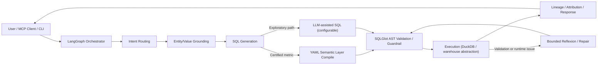

# Technical Case Study — Governed NL-to-Analytics Agent (1–2 Pages)

**Project:** `agentic-bi-warehouse`  
**Role:** `[Your role — e.g., AI/Data Engineer / Independent Builder]`  
**Period:** `[Start date – end date / ongoing]`  
**Status:** Repo-local prototype / portfolio project (update if deployed)  
**Links:** `[GitHub repo URL]` · `[Demo video URL]` · `[Architecture doc]` · `[Benchmark harness/results]` · `[Live demo URL if any]`

> **Evidence note:** This case study is grounded in repository implementation and docs. Avoid adding production metrics, customer outcomes, or benchmark claims unless they are reproducibly documented with setup details (commit, dataset, environment, command).

## Executive Summary

Natural-language analytics systems often fail in production-like conditions because generated SQL can misinterpret business logic, produce unsafe statements, or return misleading results due to join/fan-out and value-mapping errors. `agentic-bi-warehouse` explores a governed alternative: an NL-to-analytics agent where **certified business metrics are compiled from a YAML semantic layer**, **all SQL is validated by a SQLGlot AST guardrail before execution**, and execution runs against a real dataset in DuckDB with an architecture designed for broader warehouse support.

The prototype combines LangGraph orchestration, deterministic governance for certified metrics, bounded reflexion/repair, MCP tool exposure, and optional LLM-assisted steps via Sarvam Token Factory (OpenAI-compatible). The result is a portfolio-grade reference implementation for safer agentic BI workflows.

## 1. Problem

### Business/user problem
Data consumers want to ask questions in natural language (e.g., revenue, order performance, delivery quality, customer satisfaction) without writing SQL. However, business stakeholders need answers that are:
- **Correctly defined** (e.g., GMV/AOV exclusions and formula logic),
- **Safe to execute** (no mutating or risky SQL),
- **Explainable and reproducible** (traceable to metric definitions and query logic).

### Technical problem
Naive Text-to-SQL approaches are brittle on real schemas and business semantics:
- **Metric hallucination:** LLMs may invent formulas or omit business filters.
- **Join/fan-out traps:** multi-fact joins (e.g., order items + payments) can inflate aggregates.
- **Value mismatch:** user phrasing (“São Paulo”, “credit card”) may not match stored codes/values.
- **Unsafe execution:** generated SQL can include DDL/DML or risky functions if not constrained.
- **Operational fragility:** single-shot SQL generation lacks structured validation and repair.

## 2. Constraints

| Constraint | Implication for design |
|---|---|
| **Governance first** | Certified metrics must come from controlled definitions, not free-form LLM SQL. |
| **Safety before execution** | Every SQL statement must pass AST validation before hitting the execution layer. |
| **Reproducible local demo** | The system should run locally with minimal setup (DuckDB + Parquet). |
| **Realistic data shape** | Use a real-world dataset with multiple related tables to surface join/semantic issues. |
| **Extensibility** | Keep a path to poly-warehouse/connectors without rewriting agent/semantic logic. |
| **LLM variability** | LLM-assisted steps must degrade safely (fallbacks/bounded repair), preserving deterministic governance. |
| **Portfolio evidence standard** | Claims must be traceable to repo code/docs/benchmarks; no unverifiable production outcomes. |

## 3. Architecture

### High-level flow

### Core components (repo mapping)

| Component | Responsibility | Repo references |
|---|---|---|
| Orchestrator / graph | Multi-stage NL analytics workflow; engine selection (`langgraph`/`legacy`) | `src/agents/orchestrator.py`, `src/graph/workflow.py`, `src/graph/nodes.py` |
| Semantic layer | Certified metric definitions, models, loading/resolution | `config/semantic_layer.yaml`, `src/semantic/*` |
| Security / guardrails | SQLGlot AST validation and SQL transpilation controls | `src/security/ast_validator.py`, `src/security/transpiler.py` |
| Execution layer | DuckDB execution, connectors/abstractions, lineage/profiling/cache primitives | `src/engine/*`, `docs/unified-warehouse-abstraction.md` |
| Entity grounding | Maps user phrases to dataset/domain values (e.g., states/payment/status patterns) | `src/agents/entity_grounder.py` |
| Attribution / diagnostics | “Why” analysis patterns (e.g., variance/root-cause style diagnostics) | `src/agents/attribution.py` |
| Interface surfaces | CLI demo and MCP server for governed analytics tools | `demo.py`, `src/cli.py`, `src/mcp/server.py` |
| LLM integration | Sarvam Token Factory OpenAI-compatible client/factory; configurable model roles | `src/llm/factory.py`, `src/core/config.py`, `.env.example` |

### Data context
- **Dataset:** Olist Brazilian E-Commerce (real-world public dataset), represented locally as Parquet.
- **Scale in repo docs:** ~550k+ rows across 8 tables (`orders`, `order_items`, `order_payments`, `order_reviews`, `customers`, `products`, `sellers`, `category_translation`).
- **Why this dataset:** contains realistic multi-table relationships and analytics pitfalls (filters, joins/fan-out, categorical mappings, delivery/CSAT analysis).

## 4. Key Decisions & Tradeoffs

| Decision | Rationale | Tradeoff / mitigation |
|---|---|---|
| **Certified metrics compile from YAML, not LLM SQL** | Business logic must be reviewable and deterministic for governed KPIs. | Less flexible than free-form SQL for novel metrics; mitigate by supporting exploratory paths separately and expanding semantic definitions. |
| **SQLGlot AST validation before execution** | Parse/inspect SQL structurally rather than relying on prompt instructions alone. | Guardrails require careful policy design and tests; AST checks reduce risk but are not a substitute for full platform IAM/network controls. |
| **LangGraph for orchestration** | Makes multi-step agent flow explicit (route → ground → generate → validate → execute → synthesize/repair). | Adds orchestration complexity; mitigate with state contracts, node boundaries, and a legacy deterministic fallback mode. |
| **DuckDB + Parquet for local-first execution** | Fast, reproducible demos without cloud credentials; strong fit for portfolio evaluation. | Local engine behavior differs from cloud warehouses; mitigate with SQL transpilation/abstraction design and connector-specific validation as implemented. |
| **Poly-warehouse abstraction (design/architecture)** | Preserves path to PostgreSQL/Snowflake/BigQuery/ClickHouse-style targets without rewriting core semantics. | Connector maturity and parity can vary; publish only implemented/supported connectors as verified. |
| **Sarvam Token Factory (OpenAI-compatible) for selected tasks** | Uses LLM assistance where it helps (routing/grounding/exploratory SQL/narrative) while preserving governance. | External model dependency and variability; mitigate with config-driven models, fallbacks, and deterministic certified-metric compilation. |
| **Bounded reflexion/repair** | Improves robustness when validation/execution fails. | Repair loops can increase latency/cost; bound attempts and surface errors/telemetry. |
| **MCP exposure** | Makes governed analytics callable from compatible agent clients (Claude/Cursor-style workflows). | Requires clear tool contracts and safe defaults; document auth/scope expectations when deployed beyond local demos. |

## 5. Safety & Governance

### Controls implemented/designed in repo
- **Deterministic certified metrics:** metric formulas/filters/joins are defined in `config/semantic_layer.yaml`; certified SQL is compiled from config.
- **AST firewall before execution:** SQL is parsed and validated (SQLGlot) prior to running. Architecture/docs describe read-only/query-shape enforcement, blocked risky patterns/functions, and safeguard constraints (e.g., limit/join protections as implemented).
- **Grounding layer:** maps natural-language entities/values to known dataset values to reduce empty-result and mismatch failures.
- **Bounded repair:** validation/runtime errors can trigger limited repair attempts rather than unbounded retries.
- **Fallback behavior:** graph can use deterministic fallbacks when LLM paths fail/unavailable; legacy engine mode preserves original deterministic pipeline.
- **MCP governed tools:** exposes specific analytics actions (`list_governed_metrics`, `get_dataset_schema`, `query_analytics_warehouse`) rather than arbitrary shell/database access.

### Safety boundaries to state explicitly
- This is **not** a claim of complete security against all SQL/LLM threats.
- Production deployments would additionally require: warehouse IAM/RBAC, network controls, secrets management, query cost controls, audit logging, PII policies, and environment-specific policy testing.

## 6. Results (use only verifiable data)

### Verified implementation outcomes (repo-backed)
- Working governed NL-to-analytics prototype with **CLI demo**, **MCP server**, and **LangGraph + legacy engine modes**.
- **YAML semantic layer** with certified metric definitions for Olist analytics use cases.
- **SQLGlot-based validation/guardrail path** integrated before execution.
- **DuckDB/Parquet** execution over a real multi-table e-commerce dataset.
- **Bounded reflexion/repair** and deterministic fallback patterns implemented.

### Benchmark/evaluation placeholders (fill from repo evidence)
| Metric / check | Result | Source / command | Commit/date/env |
|---|---:|---|---|
| Execution accuracy (project harness definition) | `[value or N/A]` | `[e.g., make eval / eval/benchmark_runner.py]` | `[commit/date/env]` |
| AST safety/pass checks | `[value or N/A]` | `[benchmark/test source]` | `[commit/date/env]` |
| Query latency (p50/p95) | `[value or N/A]` | `[benchmark source]` | `[commit/date/env]` |
| Supported query classes | `[list]` | `[README/demo/tests]` | `[commit/date]` |

> If benchmark numbers are published (e.g., README scorecard), reproduce them or clearly label them as project-harness results with the exact command and environment.

## 7. Lessons Learned

- **Governance belongs in configuration and validation, not prompts.** Prompts can assist routing and phrasing, but certified business logic is safer when compiled from explicit semantic definitions.
- **Real datasets expose agentic BI failure modes quickly.** Multi-table joins, coded categorical values, and metric edge cases (e.g., exclusions, fan-out) are where naive Text-to-SQL breaks down.
- **AST-level controls are a practical safety layer.** SQLGlot enables structural checks that are easier to reason about than string-based filtering.
- **Reliability needs bounded recovery paths.** Reflexion/repair is useful, but it must be constrained and observable to avoid loops and unpredictable behavior.
- **Local-first demos improve credibility.** DuckDB + Parquet makes the system easy to inspect and run; a poly-warehouse abstraction then communicates production intent without overclaiming deployment.

## 8. Next Steps (if productionized)

- Add/validate warehouse connectors with dialect-specific integration tests and credential-safe deployment docs.
- Expand semantic coverage (metrics, dimensions, synonyms, join policies) with SME review workflows.
- Build an evaluation suite with golden questions, expected SQL/results or semantic assertions, and safety regression tests.
- Add observability: query/AST decision logs, lineage traces, cost/latency metrics, and repair outcome telemetry.
- Integrate policy controls for RBAC/row-level security patterns, approved tables/functions, and PII handling as required by the target environment.
- Define MCP authentication/authorization and deployment boundaries for shared environments.

## Appendix — Demo Script (optional)

1. Ask a certified metric question (e.g., GMV/AOV/CSAT by supported dimension). `[sample question]`
2. Show semantic metric definition in `config/semantic_layer.yaml`.
3. Show generated/compiled SQL and AST validation step.
4. Show execution result in DuckDB.
5. Trigger a bounded repair or clarification case (if supported by the chosen prompt). `[sample question]`
6. Show MCP tool invocation (optional). `[MCP client + command]`