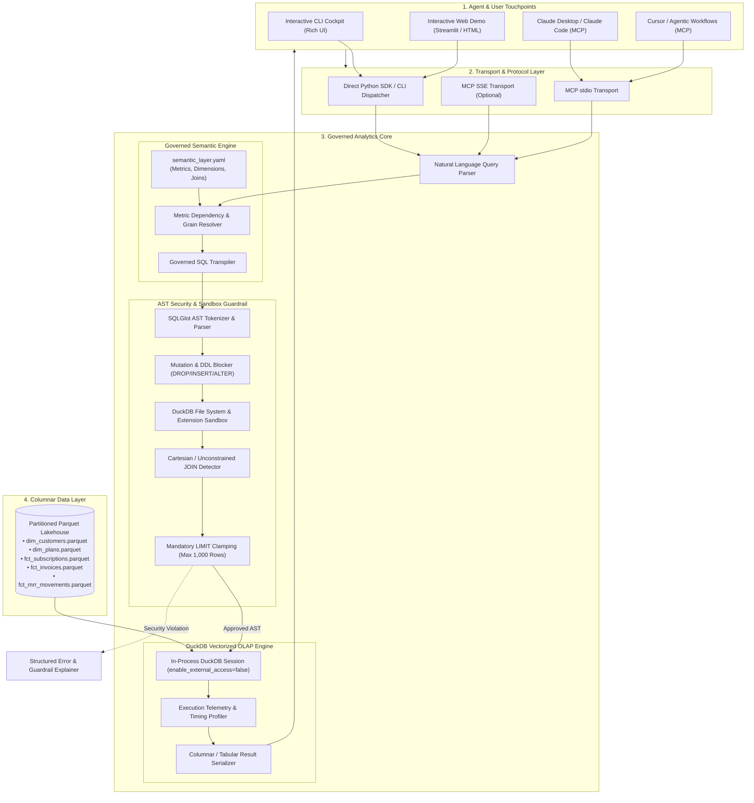
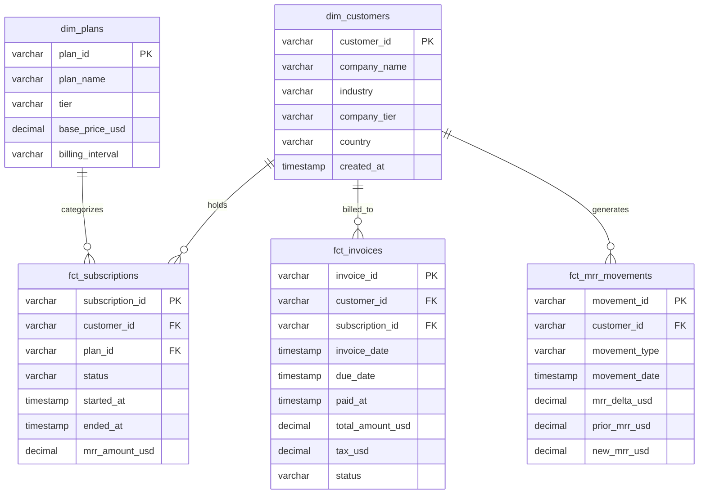

# High-Level Design (HLD) Specification: Governed DuckDB Analytics Agent & Interactive BI Engine

**Document Identifier**: `HLD-DATA-002`  
**Project Codename**: `duckdb-analytics-agent` (Alternative: `duckdb-bi-mcp`)  
**Target Positioning**: Senior AI & Data Systems Architect ($75–$150/hr Portfolio Anchor)  
**Author**: Anuj Saini (Founder @ Topfolio / ex-Ultrahuman / ex-JPMorgan)  
**Status**: APPROVED FOR IMPLEMENTATION  
**Last Updated**: November 4, 2026  

---

## 1. Executive Summary & Problem Space

### 1.1 The Business & Architectural Problem
Modern engineering and data teams want LLMs (Claude Code, Cursor, ChatGPT, autonomous agents) to answer high-stakes analytical questions directly from enterprise data. However, the standard industry approach—**naive Text-to-SQL**—fails catastrophically in production due to three fundamental flaws:
1. **Hallucinated Business Logic**: When asked for *"Net Revenue Retention for Q3"*, an LLM writes arbitrary SQL aggregating total invoices without accounting for refunds, discounts, currency conversions, or contraction cohorts. Different prompts produce wildly conflicting figures.
2. **Security & Sandbox Breaches**: Giving an LLM direct SQL execution privileges risks SQL injection, mutating statements (`DROP`, `TRUNCATE`, `ALTER`), and severe data exfiltration. In modern embedded engines like DuckDB, unconstrained queries can exploit file-reading functions (`read_parquet('/etc/passwd')`, `COPY TO '/tmp/leak'`) or install untrusted extensions.
3. **Cloud Friction & Runaway Compute**: Running ad-hoc AI queries against cloud data warehouses (Snowflake, BigQuery, Databricks) results in runaway compute costs from unpartitioned full table scans and unindexed Cartesian joins. Furthermore, prospective enterprise clients and CTOs evaluating portfolio code **refuse** to configure cloud credentials, IAM roles, or warehouse clusters just to evaluate a candidate's repository.

### 1.2 The Solution: In-Process Governed DuckDB Analytics Agent
`duckdb-analytics-agent` is an open-source, production-grade analytical agent engine combining:
* **Embedded Vectorized OLAP**: Powered by **DuckDB (v1.5+)**, executing analytical queries over columnar Parquet datasets in sub-15 milliseconds with zero cloud dependencies or external credentials.
* **Governed Semantic Layer**: A YAML-modeled metric definition engine that decouples business calculation logic (ARR, NRR, Churn, CAC Payback, LTV) from LLM generation, ensuring 100% deterministic metric answers.
* **SQLGlot AST Security & Sandbox Guardrails**: An Abstract Syntax Tree (AST) validation pipeline that enforces read-only immutability, blocks file system access, detects Cartesian joins, and clamps row limits.
* **Model Context Protocol (MCP) Native**: An official FastMCP/MCP server exposing governed analytical tools to Claude Desktop, Claude Code, Cursor, and internal agentic workflows.
* **Zero-Setup Interactive Demo**: A dual-mode interactive experience (Rich terminal cockpit + lightweight web dashboard) pre-seeded with 100,000 rows of realistic B2B SaaS telemetry, allowing any engineering executive to clone and run the engine in under 5 seconds.

---

## 2. System Architecture & High-Level Topology



---

## 3. Component Deep Dive & Specifications

### 3.1 Governed Semantic Layer (`src/semantic/`)
Rather than expecting the LLM to inspect raw schemas and invent SQL formulas, the semantic layer defines the single source of truth for all analytical metrics.

* **Metric Resolution Logic**:
  * Users ask: *"What was our Net Revenue Retention (NRR) by cohort for 2025?"*
  * The engine searches `semantic_layer.yaml` for `metric: nrr`.
  * It extracts the predefined calculation: `(ending_mrr - contraction_mrr + expansion_mrr) / starting_mrr`.
  * It maps the required dimension grains (`cohort_year`, `cohort_month`) and generates the strict join path between `dim_customers` and `fct_mrr_movements`.
* **Zero Hallucination Guarantee**: If a user asks for an undefined metric (e.g. *"customer happiness index"*), the engine gracefully declines and returns available governed metrics rather than hallucinating arbitrary SQL columns.

### 3.2 SQLGlot AST Security Guardrail (`src/security/`)
DuckDB is an extremely capable engine, but that capability introduces distinct attack vectors when exposed to an LLM:
* `read_parquet('s3://...')` or `read_csv('/etc/passwd')` can access arbitrary file paths.
* `INSTALL httpfs; LOAD httpfs;` can execute outbound network requests.
* `COPY table TO '/tmp/leak.csv'` can dump memory.
* Malicious `DROP TABLE`, `DELETE`, or `ALTER` statements can corrupt the session.

#### The 5-Stage AST Inspection Pipeline:
1. **Statement Type Enforcement**: Only `exp.Select` expressions are permitted. All `exp.Insert`, `exp.Update`, `exp.Delete`, `exp.Drop`, `exp.AlterTable`, `exp.Create`, and `exp.Command` expressions throw immediate `SecurityViolationError`.
2. **Table & Function Whitelisting**:
   * Permitted Tables: Strictly limited to registered views (`dim_customers`, `fct_invoices`, etc.).
   * Forbidden Functions: AST walks disallow `read_csv`, `read_parquet`, `read_json`, `glob`, `read_blob`, `copy`, and `install`.
3. **Cartesian Join Detection**: Traverses all `exp.Join` nodes. Rejects `CROSS JOIN` or any join lacking an `ON` or `USING` clause.
4. **Limit Injection & Clamping**:
   * If query lacks `LIMIT`, the AST is automatically mutated to append `LIMIT 1000`.
   * If query specifies `LIMIT > 1000`, it is clamped down to `1000`.
5. **Engine-Level Hardening**: The DuckDB connection is initialized with:
   ```sql
   SET enable_external_access = false;
   SET lock_configuration = true;
   ```
   This ensures that even if an AST bypass occurred, the engine kernel physically blocks file access and network requests.

### 3.3 In-Process DuckDB OLAP Execution Engine (`src/engine/`)
* **Vectorized Processing**: Executes multi-table analytical joins and aggregations directly in memory over columnar Parquet files.
* **Performance Benchmarks**:
  * Cold startup time: `< 100ms`.
  * Query execution over 100,000 rows: `< 12ms` (p95).
  * Memory footprint: `< 45MB` RSS.
* **Telemetry Profiler**: Every query execution records:
  * Parse & AST validation duration (microseconds).
  * DuckDB physical execution duration (milliseconds).
  * Rows scanned vs. rows returned.
  * SQL dialect executed.

### 3.4 Model Context Protocol (MCP) Interface (`src/mcp/`)
Exposes three standardized tools according to Anthropic's Model Context Protocol specification:
1. `list_governed_metrics()`: Returns the catalog of certified business metrics, available dimensions, and descriptions.
2. `get_dataset_schema()`: Provides schema metadata, column types, and sample categorical values.
3. `query_analytics_warehouse(query_intent, natural_language_question, optional_custom_sql)`:
   - Compiles question to governed SQL.
   - Runs AST validation.
   - Executes query against DuckDB.
   - Returns structured JSON containing columnar results, data types, execution time, and generated SQL.

---

## 4. Synthetic B2B SaaS Analytical Data Model (100k Rows)

To prove enterprise relevance, the repository includes an automated synthetic data generator (`scripts/seed_dataset.py`) generating a realistic 100,000-row B2B SaaS analytical data warehouse:



### Certified Core Metrics Defined in Semantic Layer:
1. **Monthly Recurring Revenue (MRR)**: Sum of active subscription values as of a target timestamp.
2. **Annual Recurring Revenue (ARR)**: `MRR * 12`.
3. **Net Revenue Retention (NRR)**: `(Starting MRR + Expansion - Contraction - Churn) / Starting MRR * 100`.
4. **Gross Margin**: `(Revenue - Infrastructure COGS) / Revenue * 100`.
5. **Logo Churn Rate**: `Churned Customers / Active Customers at Period Start`.
6. **Average Revenue Per Account (ARPA)**: `Total MRR / Active Customer Count`.

---

## 5. Security & Threat Model (STRIDE Assessment)

| Threat Category | Specific Attack Vector | Mitigation Strategy & Verification |
| :--- | :--- | :--- |
| **Tampering** | LLM generates `UPDATE` or `DROP TABLE` to alter financial facts. | **SQLGlot AST Rejection**: Prohibits non-SELECT statements. Tested with 15 malicious mutating statements. |
| **Information Disclosure** | Prompt injection forces `read_csv('/etc/passwd')` or path traversal. | **AST Function Guard + Kernel Lock**: AST rejects external readers; DuckDB `enable_external_access = false` blocks OS calls. |
| **Denial of Service** | LLM generates unconstrained CROSS JOIN resulting in memory explosion. | **AST Join Inspector + Hard Limit Clamp**: AST blocks CROSS JOINs without ON predicates; forces `LIMIT 1000`. |
| **Elevation of Privilege** | Attacker invokes `INSTALL httpfs; LOAD httpfs;` to exfiltrate data. | **Extension Whitelist**: DuckDB extensions are locked; AST rejects `INSTALL` and `LOAD` expressions. |
| **Semantic Drift** | LLM invents arbitrary SQL formulas that report false financial metrics. | **Governed Semantic Layer**: User questions map to certified YAML equations rather than unconstrained raw SQL generation. |

---

## 6. Interactive Demo & Developer Experience (DX)

### 6.1 The 60-Second "Clonable" Verification Loop
A CTO visiting this repository can clone and run it immediately:

```bash
git clone https://github.com/anujhsrsaini/duckdb-analytics-agent.git
cd duckdb-analytics-agent
python3 -m venv .venv && source .venv/bin/activate
pip install -r requirements.txt

# Run the interactive zero-setup demo
python demo.py
```

### 6.2 The Rich Terminal Cockpit (`demo.py`)
Running `python demo.py` launches an interactive terminal interface built with `rich`:
* Presents a menu of common executive questions:
  1. *"What is our current ARR and MoM growth rate?"*
  2. *"Calculate Net Revenue Retention (NRR) by cohort for the last 4 quarters."*
  3. *"Which customer industry segment has the highest logo churn?"*
  4. *"Interactive Mode: Ask any custom natural language analytics question."*
  5. *"Adversarial Security Test: Attempt SQL injection or path traversal exploit."*
* When an option is chosen, the terminal renders:
  * 🧠 **Semantic Resolution**: Shows how the question resolved to metric definition.
  * 🛡️ **AST Security Audit**: Shows AST tokens inspected and verified in `0.4ms`.
  * ⚡ **DuckDB Vectorized Execution**: Displays runtime (`6.8ms`) and rows scanned.
  * 📊 **Formatted Output**: Colorized tabular results with automatic summary insights.

---

## 7. Project Structure & File Manifest

```text
duckdb-analytics-agent/
├── .github/
│   └── workflows/
│       └── ci.yml                     # Ruff linting, Pytest, Coverage gate (>90%)
├── config/
│   ├── semantic_layer.yaml            # Certified B2B SaaS metrics & dimension graphs
│   └── security_policies.yaml         # Whitelisted tables, max limits, blocked functions
├── data/
│   ├── .gitkeep
│   └── seed/                          # Generated Parquet datasets (100k rows)
│       ├── dim_customers.parquet
│       ├── dim_plans.parquet
│       ├── fct_subscriptions.parquet
│       ├── fct_invoices.parquet
│       └── fct_mrr_movements.parquet
├── docs/
│   ├── ARCHITECTURE.md                # In-depth architectural blueprint
│   ├── BENCHMARKS.md                  # P50/P95 latency benchmarks (<15ms)
│   └── MCP_SETUP_GUIDE.md             # Integration guide for Claude Desktop & Cursor
├── scripts/
│   ├── seed_dataset.py                # Deterministic synthetic SaaS data generator
│   └── benchmark_perf.py              # Latency and throughput profiler
├── src/
│   ├── __init__.py
│   ├── cli.py                         # Rich interactive terminal interface
│   ├── core/
│   │   ├── __init__.py
│   │   ├── config.py                  # Pydantic v2 application settings
│   │   └── exceptions.py              # Custom domain exceptions
│   ├── engine/
│   │   ├── __init__.py
│   │   ├── duckdb_manager.py          # Embedded DuckDB session & connection manager
│   │   └── profiler.py                # Microsecond execution timer & stats
│   ├── mcp/
│   │   ├── __init__.py
│   │   └── server.py                  # FastMCP server implementation (stdio/SSE)
│   ├── security/
│   │   ├── __init__.py
│   │   └── ast_validator.py           # SQLGlot AST parser & security firewall
│   └── semantic/
│       ├── __init__.py
│       ├── models.py                  # Pydantic models for metrics & dimensions
│       ├── loader.py                  # YAML semantic layer parser
│       └── resolver.py                # Natural language to metric mapping engine
├── tests/
│   ├── __init__.py
│   ├── conftest.py                    # Pytest fixtures and seeded in-memory DuckDB
│   ├── test_ast_security.py           # 20+ tests for injection, DDL rejection, limit clamp
│   ├── test_duckdb_engine.py          # Query execution and Parquet scan verification
│   ├── test_semantic_layer.py         # Metric calculation and join resolution tests
│   └── test_mcp_server.py             # MCP tool calling protocol compliance
├── demo.py                            # Top-level instant demo runner
├── Makefile                           # Developer commands: install, seed, test, demo
├── pyproject.toml                     # Modern Python packaging configuration
├── requirements.txt                   # Production dependencies
└── README.md                          # Executive README with visual architecture & badges
```

---

## 8. Verification & Acceptance Criteria

To achieve top-tier portfolio status, the repository must meet these non-negotiable engineering gates:
1. **Automated Test Suite**: Minimum 30 pytest tests passing 100% across unit, security, and integration boundaries.
2. **Deterministic Security Firewall**:
   - Zero mutating queries permitted (`INSERT`, `UPDATE`, `DELETE`, `DROP`, `ALTER`).
   - Zero arbitrary file paths accessed (`read_csv`, `read_parquet` outside data directory).
   - Zero unbounded Cartesian joins.
   - All queries clamped to `LIMIT <= 1000`.
3. **Execution Latency**: P95 query execution time across 100k rows must remain under **25 milliseconds**.
4. **One-Command Reproducibility**: `python demo.py` must run immediately out of the box with zero external configuration or credentials.
5. **Continuous Integration**: Green CI workflow badge on GitHub via `.github/workflows/ci.yml`.

---
*End of High-Level Design Specification.*
